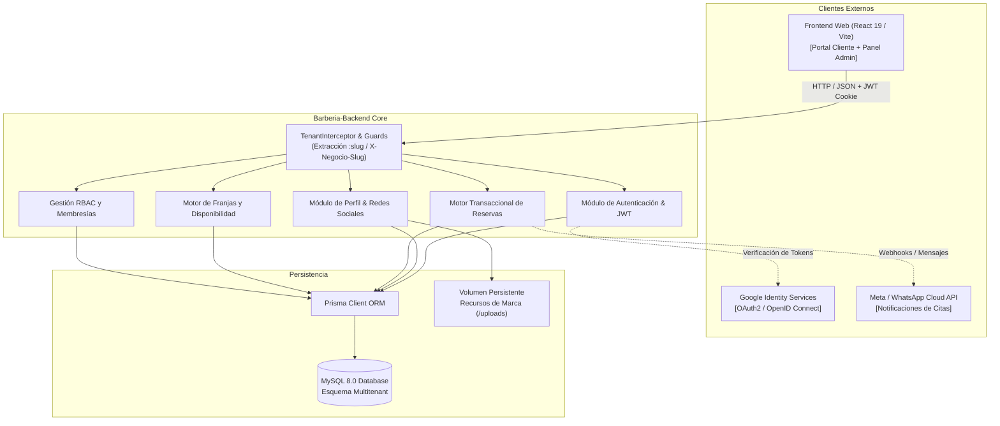

# Barbería VIP SaaS — Backend API (Core Multitenant)

> **Especificación de Arquitectura de Software bajo estándar Arc42 e IEEE 1063**  
> **Versión:** `2.0.0` · **Estado:** `Producción / Railway` · **Tests:** `28/28 Passing`

[](https://nestjs.com/)
[](https://www.typescriptlang.org/)
[](https://www.prisma.io/)
[](https://www.mysql.com/)
[](http://localhost:3000/api/docs)
[](#)

---

## 1. Introducción y Objetivos del Sistema (Arc42 §1)

El backend de **Barbería VIP SaaS** es una plataforma multitenant distribuida para la gestión integral de barberías y cadenas de estética masculina. Proporciona servicios desacoplados para agendamiento de citas en tiempo real, gestión de profesionales, control de comisiones, automatización de mensajería (WhatsApp Cloud API) y personalización visual por sede.

### 1.1 Objetivos de Calidad (Metas Arquitectónicas)
1. **Aislamiento Multitenant Estricto:** Ninguna barbería puede consultar, mutar o inferir datos de otra barbería. Cada transacción está contextualizada por `negocioId`.
2. **Seguridad y Anti-Account Takeover:** Protección de identidad global (`Usuario`) impidiendo secuestros de cuenta entre sedes mediante autenticación federada Google OAuth2 inmutable.
3. **Concurrencia Determinista:** Motor de citas libre de dobles reservas (*double-booking*) mediante bloqueos y transacciones ACID en base de datos.
4. **Alta Mantenibilidad y Documentación Viva:** Código autodocumentado con TSDoc, contratos tipados y especificación OpenAPI interactiva.

### 1.2 Stakeholders y Roles del Sistema
* **Cliente (VIP / Invitado):** Agenda citas en la sede, consulta historial y gestiona cancelaciones mediante tokens seguros o autenticación Google.
* **Barbero (Personal Operativo):** Consulta su agenda diaria, marca citas completadas o inasistencias y supervisa sus métricas.
* **Administrador de Sede:** Gestiona barberos, servicios, horarios, recursos de marca y canales oficiales de su barbería.
* **Superadmin de Sede:** Dueño o fundador de la sede con privilegios completos de configuración y facturación en su negocio.
* **Superadmin de Plataforma:** Administrador global del SaaS encargado del onboarding de nuevas barberías y auditoría general.

---

## 2. Restricciones de Arquitectura (Arc42 §2)

* **Lenguaje y Entorno:** Node.js `>= 20.x`, TypeScript configurado en modo estricto (`strict: true`).
* **Framework:** NestJS 11 con inyección de dependencias modular, pipes de validación global (`ValidationPipe` con `whitelist: true`, `transform: true`) y filtros de excepciones estándar.
* **Base de Datos:** MySQL 8.0 con aislamiento de transacciones `READ COMMITTED`.
* **Seguridad HTTP:** `Helmet` para cabeceras defensivas (CSP, HSTS, X-Frame-Options), cookies con flags `HttpOnly`, `SameSite=Lax/None` y `Secure`.

---

## 3. Contexto del Sistema (Arc42 §3)



---

## 4. Estrategia Multitenant y Membresías (Arc42 §4)

El backend opera mediante **multitenancy lógico con discriminador por columna (`negocioId`)**:

1. **Resolución de Contexto:** Cada petición es interceptada por `NegocioContextInterceptor`:
   * Vía subdominio: `<slug>.tu-dominio.com`
   * Vía encabezado HTTP: `X-Negocio-Slug: barberia-demo-2`
   * Si una ruta exige contexto y no se proporciona, el sistema responde `403 Forbidden` inmediatamente. Ningún endpoint acepta un `negocioId` inyectado por body o query.
2. **Membresías Aisladas vs Usuario Global:**
   * `Usuario`: Identidad global de la persona (`email`, `passwordHash`, `googleId`).
   * `Administrador` y `Barbero`: Membresías de trabajo vinculadas a un `negocioId`.
   * **Regla de Oro:** Un administrador de sede solo puede activar o suspender el rol de un colaborador en **su propia barbería** (`PATCH /usuarios/:id/estado?tipo=...`). Jamás puede suspender la cuenta global de la persona.

---

## 5. Estructura Modular del Backend (Arc42 §5)

```
src/
├── common/               # Utilidades, decoradores, DTOs compartidos y filtros globales
│   ├── config/           # Configuración defensiva (CORS, Helmet, Swagger)
│   ├── decorators/       # @NegocioActual, @UsuarioActual, @RolesPermitidos
│   ├── guards/           # TenantGuard, JwtAuthGuard, PlataformaAdminGuard
│   └── interceptors/     # NegocioContextInterceptor
├── modules/
│   ├── auth/             # Login local, Google OAuth, Refresh Tokens y Anti-Takeover
│   ├── negocios/         # Directorio público y onboarding de nuevas barberías
│   ├── perfil-negocio/   # Datos comerciales, GPS, theming y Redes Sociales oficiales
│   ├── usuarios/         # Administradores y Barberos con roles desacoplados
│   ├── horarios/         # Horarios semanales, excepciones y bloqueos de agenda
│   ├── reservas/         # Creación atómica de citas, cálculo de franjas de 60m y estados
│   ├── servicios/        # Catálogo de servicios y asignación a profesionales
│   └── whatsapp/         # Integración y plantillas oficiales de Meta
└── prisma/               # PrismaService y extensiones
```

---

## 6. Documentación Interactiva OpenAPI / Swagger (IEEE 1063 & OpenAPI)

El sistema expone la especificación OpenAPI 3.0 completa con esquemas DTO validados y autenticación Bearer interactiva.

* **En Desarrollo Local:**
  ```
  http://localhost:3000/api/docs
  ```
* **En Producción (Railway):**
  Por estándar de seguridad OWASP A05 (*Security Misconfiguration*), Swagger está protegido por defecto en producción. Se habilita para evaluadores y frontend configurando en Railway la variable de entorno:
  ```env
  SWAGGER_HABILITADO=true
  ```
  URL: `https://barberia-backend-production.up.railway.app/api/docs`

---

## 7. Guía de Instalación y Puesta en Marcha (IEEE 1063)

### 7.1 Requisitos Previos
* **Node.js:** `>= 20.11.0`
* **Docker Desktop:** `>= 24.x` (para MySQL 8.0 local)
* **Gestor de paquetes:** `npm` o `pnpm`

### 7.2 Paso a Paso de Despliegue Local

1. **Clonar el repositorio:**
   ```bash
   git clone https://github.com/dfelipe7/Barberia-Backend.git
   cd Barberia-Backend
   ```

2. **Instalar dependencias:**
   ```bash
   npm install
   ```

3. **Configurar variables de entorno:**
   ```bash
   # En Windows PowerShell
   copy .env.multitenant-dev.example .env.multitenant-dev
   ```

4. **Levantar base de datos aislada con Docker:**
   ```bash
   docker compose -f docker-compose.multitenant-dev.yml up -d mysql-multitenant-dev
   ```

5. **Ejecutar migraciones y semillero (Seeds):**
   ```bash
   # Aplicar migraciones sobre MySQL
   npx prisma migrate deploy

   # Cargar barberías demo, barberos y fundadores
   npm run seed:local:multitenant
   ```

6. **Arrancar en modo desarrollo:**
   ```bash
   npm run start:dev
   ```
   El servidor estará disponible en `http://localhost:3000`.

---

## 8. Decisiones de Arquitectura Registradas (ADRs)

* **ADR-001 · Multitenancy con Esquema Compartido:** Se adoptó un discriminador por columna (`negocioId`) indexado de forma compuesta (`@@index([negocioId, estado])`), maximizando la eficiencia de recursos y simplificando migraciones sin el sobrecosto operacional de una base de datos por tenant.
* **ADR-002 · Verificación Anti-Account Takeover:** Se validó estrictamente que el `googleId` coincida con el identificador federado `sub`. Si un usuario intenta autenticarse con una cuenta Google distinta a la registrada originalmente para su correo, el sistema arroja `401 Unauthorized` bloqueando el secuestro de identidad.
* **ADR-003 · Aislamiento de Membresías por Sede:** Se desacopló la identidad (`Usuario`) de la relación contractual (`Administrador` / `Barbero`), permitiendo que una persona labore en múltiples barberías sin que el bloqueo en una de ellas afecte su operación en las demás.
* **ADR-004 · Inmutabilidad del Correo Electrónico:** Se prohibió la edición del campo `email` desde los paneles administrativos de sede para mitigar escalación cruzada de privilegios entre tenants.

---

## 9. Seguridad y Aseguramiento de Calidad (SAST & SCA)

* **SAST (Static Application Security Testing):**
  * Uso obligatorio de **Prisma ORM**, garantizando consultas SQL parametrizadas inmunes a Inyecciones SQL (SQLi).
  * Validación estricta con `class-validator` y `class-transformer` impidiendo inyecciones de campos no permitidos (`forbidNonWhitelisted: true`).
* **SCA (Software Composition Analysis):**
  * Auditoría periódica de dependencias con `npm audit` / `pnpm audit` para certificar la ausencia de vulnerabilidades conocidas (CVEs).
* **Pruebas Automatizadas:**
  * Suite de pruebas unitarias con Jest:
    ```bash
    npm run test
    ```
    *Resultado:* **28/28 tests unitarios pasando limpiamente**.

---

## 10. Gobernanza y Human-in-the-Loop (HITL)

Este repositorio aplica las reglas de gobernanza asistida por IA documentadas en:
* [`AGENTS.md`](./AGENTS.md): Reglas de operación, contratos inmutables y límites éticos de los agentes de IA.
* [`TECH_DEBT.md`](./TECH_DEBT.md): Registro vivo de decisiones diferidas y mejoras técnicas.
* `.githooks/`: Hooks de pre-commit que aseguran la inclusión obligatoria de trailers de trazabilidad (`AI-Assisted-By`, `AI-Model`, `AI-Session`) y la previa aprobación explícita de un humano.

---
*Documento mantenido de conformidad con las directrices de Ingeniería de Software, Arc42 e IEEE 1063.*
