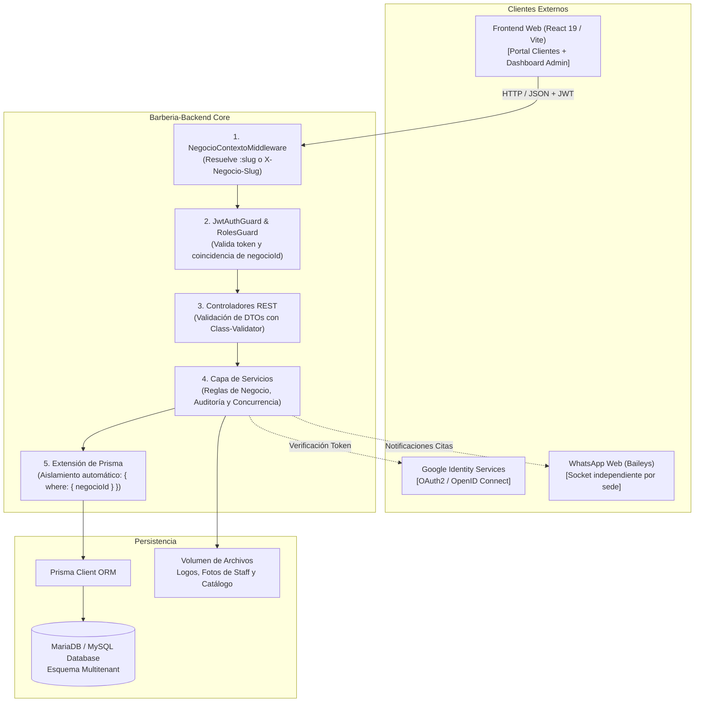

# 💈 Barbería VIP SaaS — Backend Core API

[](https://nestjs.com/)
[](https://www.typescriptlang.org/)
[](https://www.prisma.io/)
[](https://www.mysql.com/)
[](http://localhost:3000/api/docs)
[](https://jestjs.io/)

---

## 📌 ¿Qué es este proyecto? (Contexto del Sistema)

**Barbería VIP SaaS** es una plataforma multitenant en la nube diseñada para la gestión integral de cadenas de barberías, peluquerías masculinas y estudios de estética.

El sistema resuelve la necesidad de operar múltiples negocios independientes bajo una única infraestructura centralizada:
* **Cada barbería tiene su propio entorno aislado:** Catálogo de servicios, precios, horarios, equipo de barberos, comisiones, reglas de cancelación y personalización de marca.
* **Sesiones independientes de WhatsApp Web:** Cada sede vincula su propio número telefónico para emitir confirmaciones y recordatorios automáticos sin mezclarse con otras sedes.
* **Modelo B2B2C:** Permite a los clientes finales reservar citas en línea sin fricción y al personal gestionar su jornada diaria desde cualquier dispositivo.

---

## 🔄 ¿Cómo funciona el Backend? (Arquitectura & Flujo de Datos)

El backend está construido con **NestJS 11** siguiendo los principios de la Arquitectura Limpia y el modelo **Multitenant Zero-Trust** (discriminador por columna `negocioId` con propagación asíncrona mediante `AsyncLocalStorage`):



---

## 👥 Roles del Sistema (Modelo de Acceso RBAC)

| Rol | Alcance | Responsabilidades Principales |
| :--- | :--- | :--- |
| **Cliente / Invitado** | Sede actual | Reserva citas públicas, consulta disponibilidad en tiempo real, gestiona o cancela sus citas mediante token de seguridad o inicio de sesión con Google. |
| **Barbero** | Sede asignada | Consulta su agenda semanal de turnos, configura sus horarios y descansos, marca citas completadas o inasistencias (*No Show*) y consulta comisiones. |
| **Administrador de Sede** | Sede propia | Gestiona el equipo de barberos, catálogo de servicios, precios, horarios del local, plantillas y vinculación de WhatsApp Web, y configuración visual. |
| **Superadmin de Sede** | Sede propia | Propietario del negocio con acceso total a métricas financieras, configuración comercial y auditoría de su barbería. |
| **Superadmin de Plataforma** | Global SaaS | Administrador general de la plataforma: creación y onboarding de nuevas barberías, auditoría global y soporte técnico. |

---

## ⚡ Características Principales del Core

1. **Aislamiento Multitenant Estricto (Zero-Trust):**  
   Ninguna petición HTTP puede leer ni escribir datos de otra barbería. El contexto de sede se inyecta en cada consulta a la base de datos de forma automática e inmutable.
2. **Defensa Anti-Account Takeover:**  
   La autenticación con Google vincula permanentemente el identificador federado `sub` de Google a la cuenta, previniendo secuestros de cuenta por suplantación de correo.
3. **Concurrencia Determinista en Reservas:**  
   Motor de agendamiento protegido con transacciones ACID y bloqueos pesimistas para impedir dobles reservas (*double-booking*) en la misma franja horaria.
4. **Automatización de WhatsApp Web por Sede:**  
   Gestor multi-sesión con Baileys que permite a cada barbería escanear su propio código QR y enviar recordatorios automáticos mediante tareas programadas (Cron).

---

## 🚀 Inicio Rápido (Quick Start)

### 1. Prerrequisitos
* **Node.js** `>= 20.x`
* **MariaDB** o **MySQL** `>= 8.0`

### 2. Puesta en Marcha en Local

```bash
# 1. Clonar el repositorio y acceder a la carpeta del backend
cd Barberia-Backend

# 2. Instalar dependencias
npm install

# 3. Configurar variables de entorno
cp .env.example .env
# Completa en .env: DATABASE_URL, JWT_SECRET, GOOGLE_CLIENT_ID

# 4. Sincronizar el esquema de la base de datos con Prisma
npx prisma migrate deploy

# 5. Iniciar el servidor en modo desarrollo
npm run start:dev
```

El servidor estará escuchando en `http://localhost:3000`.

---

## 📚 Endpoints & Documentación Interactiva

* **Swagger / OpenAPI UI en vivo:** [`http://localhost:3000/api/docs`](http://localhost:3000/api/docs)
* **Health Check del Sistema:** `GET http://localhost:3000/health`

---

## 🛠️ Comandos Disponibles

| Comando | Descripción |
| :--- | :--- |
| `npm run start:dev` | Inicia el backend con recarga en caliente (*Hot-Reload*). |
| `npm run build` | Compila el proyecto en TypeScript a código de producción en `dist/`. |
| `npm run start:prod` | Ejecuta la versión compilada en entornos de producción. |
| `npm test` | Ejecuta las suites de pruebas automatizadas con Jest (más de 1200 tests). |
| `npm run typecheck` | Comprobación estricta de tipos (`tsc --noEmit`). |
| `npm run docs:html` | Genera localmente el portal HTML de documentación con TypeDoc en `docs/html/`. |
| `npm run openapi:export` | Exporta la especificación formal OpenAPI v3.0 en `docs/api/openapi.json`. |

### 📚 Generación y Visualización de la Documentación (TypeDoc / TSDoc)

Para compilar y visualizar el portal HTML con la documentación de clases, controladores, servicios y contratos TSDoc:

```bash
# 1. Compilar el portal de documentación técnica en HTML
npm run docs:html

# 2. Abrir en el navegador el portal generado
# En Windows (PowerShell/CMD):
start docs/html/index.html

# En macOS:
open docs/html/index.html

# En Linux:
xdg-open docs/html/index.html
```

> [!NOTE]
> La carpeta generada `docs/html/` se crea de forma local y está excluida deliberadamente en `.gitignore` para no sobrecargar el repositorio Git. Cada miembro del equipo o evaluador puede generarla en cualquier momento ejecutando `npm run docs:html`.

### 🌐 Exportación de la Especificación OpenAPI 3.0 (JSON)

Para regenerar el archivo estático formal OpenAPI que describe todos los endpoints, esquemas de datos y códigos de respuesta HTTP para Postman o Swagger Editor:

```bash
# Exportar el contrato REST completo a docs/api/openapi.json
npm run openapi:export
```

> El archivo resultante queda guardado en [`docs/api/openapi.json`](docs/api/openapi.json) y puede arrastrarse directamente a Postman, Insomnia o [editor.swagger.io](https://editor.swagger.io) sin necesidad de levantar el servidor.

---

## 📖 Estándares Internacionales & Documentación Detallada

* **🏛️ Memoria de Arquitectura Arc42:** Consulta [`docs/arc42/`](docs/arc42/) para acceder a los 12 capítulos canónicos formales (ADRs, vistas C4, despliegue, matrices de riesgo y glosario).
* **🌐 Especificación OpenAPI 3.0 (Swagger):** Consulta [`docs/api/openapi.json`](docs/api/openapi.json) para el contrato REST formal en formato JSON exportado (importable en Postman o Swagger Editor).
* **📖 Manual de Usuario (IEEE 1063):** Consulta [`docs/MANUAL_DE_USUARIO.md`](docs/MANUAL_DE_USUARIO.md) para la guía operativa paso a paso por roles (Clientes, Barberos, Administrador, Bot WhatsApp).
* **📘 Plan & Guía de Estilo Documental (ISO/IEC/IEEE 26514):** Consulta [`docs/PLAN_DE_DOCUMENTACION_ISO_26514.md`](docs/PLAN_DE_DOCUMENTACION_ISO_26514.md) para las directrices de diseño editorial, taxonomía y ciclo de vida documental.
* **🛡️ Marco de Seguridad y Testing (SAST, SCA, IAST, DAST):** Consulta [`docs/SEGURIDAD_Y_TESTING.md`](docs/SEGURIDAD_Y_TESTING.md) para la matriz comparativa de técnicas de seguridad, auditoría OWASP Top 10 y workflows CI/CD.
* **🗄️ Diccionario de Datos & Modelo ER:** Consulta [`docs/DICCIONARIO_DE_DATOS.md`](docs/DICCIONARIO_DE_DATOS.md) para el detalle de las 16 tablas SQL, tipos, claves compuestas y diagramas de relaciones.
* **💻 Developer Architecture Hub:** Consulta [`docs/DOCS_PORTAL.md`](docs/DOCS_PORTAL.md) para el mapa de clases, servicios y contratos de software.
