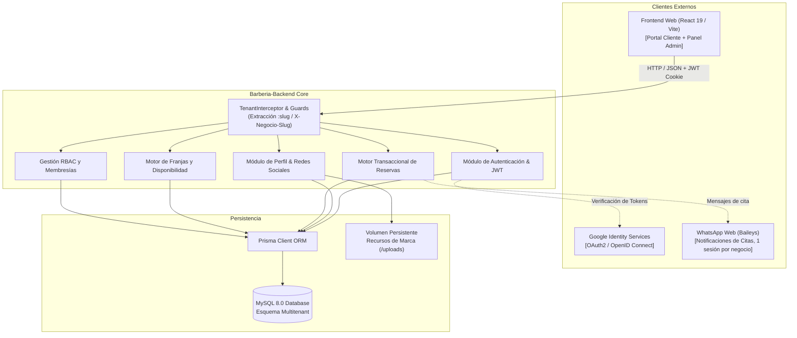
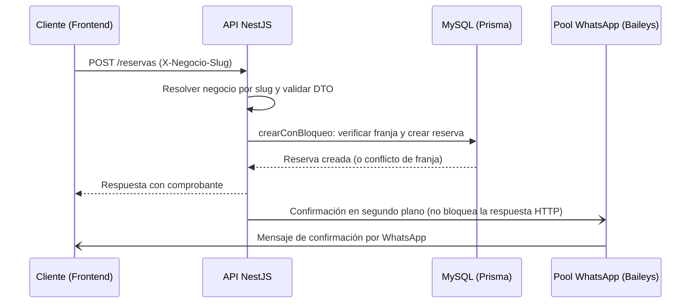

# Barbería VIP SaaS — Backend API (Core Multitenant)

> **Especificación de Arquitectura de Software bajo estándar Arc42 e IEEE 1063**  
> **Versión:** `2.0.0` · **Estado:** `Producción / Railway` · **Pruebas:** `98 suites unitarias (1227 tests) + 22 suites e2e multitenant`

[](https://nestjs.com/)
[](https://www.typescriptlang.org/)
[](https://www.prisma.io/)
[](https://www.mysql.com/)
[](http://localhost:3000/api/docs)
[](#)

---

## 1. Introducción y Objetivos del Sistema (Arc42 §1)

El backend de **Barbería VIP SaaS** es una plataforma multitenant distribuida para la gestión integral de barberías y cadenas de estética masculina. Proporciona servicios desacoplados para agendamiento de citas en tiempo real, gestión de profesionales, control de comisiones, automatización de mensajería (WhatsApp mediante Baileys, con una sesión independiente por negocio) y personalización visual por sede.

### 1.1 Objetivos de Calidad (Metas Arquitectónicas)
1. **Aislamiento Multitenant Estricto:** Ninguna barbería puede consultar, mutar o inferir datos de otra barbería. Cada transacción está contextualizada por `negocioId`.
2. **Seguridad y Anti-Account Takeover:** Protección de identidad global (`Usuario`) impidiendo secuestros de cuenta entre sedes mediante autenticación federada Google OAuth2 inmutable.
3. **Concurrencia Determinista:** Motor de citas libre de dobles reservas (*double-booking*) mediante bloqueos y transacciones ACID en base de datos.
4. **Alta Mantenibilidad y Documentación Viva:** Código autodocumentado con TSDoc, contratos tipados y especificación OpenAPI interactiva.

### 1.2 Stakeholders y Roles del Sistema
* **Cliente (VIP / Invitado):** Agenda citas en la sede, consulta historial y gestiona cancelaciones mediante tokens seguros o autenticación Google.
* **Barbero (Personal Operativo):** Consulta su agenda diaria, marca citas completadas o inasistencias y supervisa sus métricas.
* **Administrador de Sede:** Gestiona barberos, servicios, horarios, recursos de marca y canales oficiales de su barbería.
* **Superadmin de Sede:** Dueño o fundador de la sede con privilegios completos de configuración y facturación en su negocio.
* **Superadmin de Plataforma:** Administrador global del SaaS encargado del onboarding de nuevas barberías y auditoría general.

---

## 2. Restricciones de Arquitectura (Arc42 §2)

* **Lenguaje y Entorno:** Node.js `>= 20.x`, TypeScript configurado en modo estricto (`strict: true`).
* **Framework:** NestJS 11 con inyección de dependencias modular, pipes de validación global (`ValidationPipe` con `whitelist: true`, `transform: true`) y filtros de excepciones estándar.
* **Base de Datos:** MySQL 8.0 con aislamiento de transacciones `READ COMMITTED`.
* **Seguridad HTTP:** `Helmet` para cabeceras defensivas (CSP, HSTS, X-Frame-Options), cookies con flags `HttpOnly`, `SameSite=Lax/None` y `Secure`.

---

## 3. Contexto del Sistema (Arc42 §3)



---

## 4. Estrategia Multitenant y Membresías (Arc42 §4)

El backend opera mediante **multitenancy lógico con discriminador por columna (`negocioId`)**:

1. **Resolución de Contexto:** Cada petición es interceptada por `NegocioContextInterceptor`:
   * Vía subdominio: `<slug>.tu-dominio.com`
   * Vía encabezado HTTP: `X-Negocio-Slug: barberia-demo-2`
   * Si una ruta exige contexto y no se proporciona, el sistema responde `403 Forbidden` inmediatamente. Ningún endpoint acepta un `negocioId` inyectado por body o query.
2. **Membresías Aisladas vs Usuario Global:**
   * `Usuario`: Identidad global de la persona (`email`, `passwordHash`, `googleId`).
   * `Administrador` y `Barbero`: Membresías de trabajo vinculadas a un `negocioId`.
   * **Regla de Oro:** Un administrador de sede solo puede activar o suspender el rol de un colaborador en **su propia barbería** (`PATCH /usuarios/:id/estado?tipo=...`). Jamás puede suspender la cuenta global de la persona.

---

## 5. Estructura Modular del Backend (Arc42 §5)

```
src/
├── auth/                 # Login, JWT de clientes, Google OAuth y guards de sesión
├── bootstrap/            # Inicialización de datos base al arrancar
├── common/               # Código transversal
│   ├── config/           # CORS, Swagger, Multer y rutas de uploads
│   ├── decorators/       # Decoradores de contexto (negocio, usuario, roles)
│   ├── exceptions/       # Excepciones de dominio
│   ├── security/         # Detección de tipo de archivo y sanitización de SVG
│   └── validators/       # Validadores personalizados
├── logger/               # Logging de la aplicación
├── modules/
│   ├── alerts/           # Servicio de alertas
│   ├── configuracion/    # Configuración por negocio
│   ├── horarios/         # Horarios semanales, excepciones y bloqueos de agenda
│   ├── negocios/         # Directorio público y alta de nuevas barberías
│   ├── perfil-negocio/   # Datos comerciales, ubicación, tema y redes sociales
│   ├── reservas/         # Creación atómica de citas, franjas y estados
│   ├── servicios/        # Catálogo de servicios y asignación a profesionales
│   ├── usuarios/         # Administradores y barberos con roles desacoplados
│   └── whatsapp/         # Pool de sesiones Baileys y plantillas de mensajes
├── prisma/               # PrismaService
└── types/                # Tipos compartidos
```

---

## 5.1 Vista de Ejecución: Reserva y Notificación (Arc42 §6)



La confirmación por WhatsApp se dispara de forma desacoplada, con reintentos espaciados (0 s, 4 s y 10 s), y usa la sesión del `negocioId` de la reserva. `WhatsappService` mantiene además una cola de mensajes pendientes por negocio, por lo que un fallo en una sede no afecta a las demás.

---

## 5.2 Conceptos Transversales (Arc42 §8)

* **Aislamiento de archivos por negocio:** los archivos subidos se guardan en `<uploads>/negocios/{negocioId}/{carpeta}/` (`servicios`, `barberos`, …), definido en `common/config/multer.config.ts`.
* **Validación de archivos:** el tipo real se detecta por contenido (`detectar-tipo-archivo`) y los SVG se sanitizan (`sanitizar-svg`) antes de guardarse.
* **Sesiones de WhatsApp por negocio:** `WhatsappService` mantiene un `Map<negocioId, Sesión>` y una cola de mensajes pendientes por negocio. Las credenciales se guardan en `~/.barberia_whatsapp_sessions/negocio_<id>`.
* **Cabeceras y CORS:** `Helmet` y orígenes permitidos configurados en `src/main.ts` y `common/config/cors.config.ts`.
* **Validación de entrada:** `ValidationPipe` global con `forbidNonWhitelisted: true`.

---

## 6. Documentación Interactiva OpenAPI / Swagger (IEEE 1063 & OpenAPI)

El sistema expone la especificación OpenAPI 3.0 completa con esquemas DTO validados y autenticación Bearer interactiva.

* **En Desarrollo Local:**
  ```
  http://localhost:3000/api/docs
  ```
* **En Producción (Railway):**
  Por estándar de seguridad OWASP A05 (*Security Misconfiguration*), Swagger está protegido por defecto en producción. Se habilita para evaluadores y frontend configurando en Railway la variable de entorno:
  ```env
  SWAGGER_HABILITADO=true
  ```
  URL: `https://barberia-backend-production.up.railway.app/api/docs`

---

## 7. Guía de Instalación y Puesta en Marcha (IEEE 1063)

### 7.1 Requisitos Previos
* **Node.js:** `>= 20.11.0`
* **Docker Desktop:** `>= 24.x` (para MySQL 8.0 local)
* **Gestor de paquetes:** `npm` o `pnpm`

### 7.2 Paso a Paso de Despliegue Local

1. **Clonar el repositorio:**
   ```bash
   git clone https://github.com/dfelipe7/Barberia-Backend.git
   cd Barberia-Backend
   ```

2. **Instalar dependencias:**
   ```bash
   npm install
   ```

3. **Configurar variables de entorno:**
   ```bash
   # En Windows PowerShell
   copy .env.multitenant-dev.example .env.multitenant-dev
   ```

4. **Levantar base de datos aislada con Docker:**
   ```bash
   docker compose -f docker-compose.multitenant-dev.yml up -d mysql-multitenant-dev
   ```

5. **Ejecutar migraciones y semillero (Seeds):**
   ```bash
   # Aplicar migraciones sobre MySQL
   npx prisma migrate deploy

   # Cargar barberías demo, barberos y fundadores
   npm run seed:local:multitenant
   ```

6. **Arrancar en modo desarrollo:**
   ```bash
   npm run start:dev
   ```
   El servidor estará disponible en `http://localhost:3000`.

---

## 8. Decisiones de Arquitectura Registradas (ADRs)

* **ADR-001 · Multitenancy con Esquema Compartido:** Se adoptó un discriminador por columna (`negocioId`) indexado de forma compuesta (`@@index([negocioId, estado])`), maximizando la eficiencia de recursos y simplificando migraciones sin el sobrecosto operacional de una base de datos por tenant.
* **ADR-002 · Verificación Anti-Account Takeover:** Se validó estrictamente que el `googleId` coincida con el identificador federado `sub`. Si un usuario intenta autenticarse con una cuenta Google distinta a la registrada originalmente para su correo, el sistema arroja `401 Unauthorized` bloqueando el secuestro de identidad.
* **ADR-003 · Aislamiento de Membresías por Sede:** Se desacopló la identidad (`Usuario`) de la relación contractual (`Administrador` / `Barbero`), permitiendo que una persona labore en múltiples barberías sin que el bloqueo en una de ellas afecte su operación en las demás.
* **ADR-004 · Inmutabilidad del Correo Electrónico:** Se prohibió la edición del campo `email` desde los paneles administrativos de sede para mitigar escalación cruzada de privilegios entre tenants.
* **ADR-005 · Sesión de WhatsApp por negocio:** Se usa Baileys con un `Map<negocioId, Sesión>` y cola de mensajes pendientes por negocio, en lugar de una única cuenta global. Cada sede vincula su propio número y un fallo en una no afecta a las demás.
* **ADR-006 · Uploads aislados por negocio:** Los archivos se guardan bajo `<uploads>/negocios/{negocioId}/{carpeta}/`, validando su tipo real por contenido y sanitizando los SVG, para evitar que una sede acceda a archivos de otra.

---

## 9. Seguridad y Aseguramiento de Calidad

Estado de cada técnica de testing de seguridad según la guía de referencia:

| Técnica | Estado | Evidencia |
| :--- | :---: | :--- |
| **SAST** | ✅ | SonarCloud ejecutado en cada push y pull request (`.github/workflows/build.yml`, job `sonarqube`). Además `tsc --noEmit` (`npm run typecheck`) y ESLint. |
| **SCA** | ✅ | `npm audit --audit-level=high` en `.github/workflows/security-audit.yml`: en push y PR a `master`/`main` y cada lunes (`cron: 0 0 * * 1`). |
| **DAST** | ⏳ Pendiente | `scripts/testing/zap-run.mjs` es un marcador: no ejecuta OWASP ZAP por defecto y registra `status: BLOQUEADO` en `artifacts/testing/zap-status.json`. Requiere Docker, base desechable y `ZAP_ENABLED=true`. No se simulan resultados. |
| **IAST** | ➖ No aplica por ahora | No hay agente en tiempo de ejecución. |

Medidas de código complementarias:
* **Prisma ORM** con consultas parametrizadas, que evita la inyección SQL.
* **`class-validator` / `class-transformer`** con `forbidNonWhitelisted: true`, que rechaza campos no permitidos.
* **Aislamiento negativo entre negocios** verificado en suites e2e (`multitenant-aislamiento-negativo`, `seguridad-simulador`).

### Pruebas automatizadas
| Tipo | Comando | Alcance |
| :--- | :--- | :--- |
| Unitarias (Jest) | `npm run test` | 98 suites, 1227 tests |
| Cobertura | `npm run test:cov` | Informe consumido por SonarCloud |
| E2E multitenant | `npm run test:multitenant` | Suites `multitenant-*.e2e-spec.ts` |
| E2E general | `npm run test:e2e` | `test/jest-e2e.json` |

> **Nota:** en una ejecución local restringida, 7 tests fallaron con `connect EACCES 127.0.0.1` al abrir puertos locales. Están pendientes de confirmar en un entorno con red local.

---

## 10. Riesgos y Deuda Técnica (Arc42 §11)

El registro vivo de deuda técnica y decisiones diferidas está en [`TECH_DEBT.md`](./TECH_DEBT.md). Pendientes conocidos de esta documentación:
* Ejecutar DAST con OWASP ZAP y guardar el informe como evidencia.
* Confirmar el resultado completo de las pruebas que requieren puertos locales.

---

## 11. Glosario (Arc42 §12)

| Término | Significado |
| :--- | :--- |
| **Negocio / Sede / Tenant** | Una barbería registrada en la plataforma, identificada por `negocioId` y `slug`. |
| **Slug** | Identificador legible de un negocio en la URL o en el encabezado `X-Negocio-Slug`. |
| **Membresía** | Relación de una persona (`Usuario`) con un negocio como `Administrador` o `Barbero`. |
| **Baileys** | Biblioteca que conecta con WhatsApp Web; se usa una sesión por negocio. |
| **HITL** | *Human-in-the-loop*: aprobación humana obligatoria antes de confirmar cambios asistidos por IA. |

---

## 12. Gobernanza y Human-in-the-Loop (HITL)

Este repositorio aplica las reglas de gobernanza asistida por IA documentadas en:
* [`AGENTS.md`](./AGENTS.md): Reglas de operación, contratos inmutables y límites éticos de los agentes de IA.
* [`TECH_DEBT.md`](./TECH_DEBT.md): Registro vivo de decisiones diferidas y mejoras técnicas.
* `.githooks/`: Hooks de pre-commit que aseguran la inclusión obligatoria de trailers de trazabilidad (`AI-Assisted-By`, `AI-Model`, `AI-Session`) y la previa aprobación explícita de un humano.

---
*Documento mantenido de conformidad con las directrices de Ingeniería de Software, Arc42 e IEEE 1063.*
