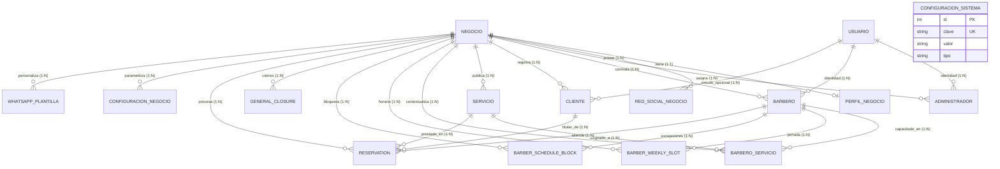

# 🗄️ Diccionario de Datos & Modelo Entidad-Relación (DER)

> **Sistema:** Barbería VIP SaaS — Plataforma Multitenant de Gestión y Agendamiento  
> **Motor de Base de Datos:** MariaDB / MySQL 8.0 (`READ COMMITTED`)  
> **ORM de Acceso:** Prisma Client 7.x con Extensiones de Aislamiento  
> **Estándar:** IEEE 1063 / Arc42 §5 (Persistencia)

---

## 1. 🗺️ Diagrama Entidad-Relación (ERD)

---

## 2. 📑 Catálogo de Tipos Enumerados (Enums)

| Enum | Valores Permitidos | Propósito Arquitectónico |
| :--- | :--- | :--- |
| **`EstadoNegocio`** | `ACTIVO`, `INACTIVO` | Permite suspender una barbería sin borrar su histórico de datos. |
| **`EstadoUsuario`** | `ACTIVO`, `INACTIVO` | Estado operativo de cuentas de usuario y membresías de staff. |
| **`RolUsuario`** | `SUPERADMIN`, `PERSONAL` | Clasificación global heredada. Los roles reales derivan de `Administrador.superadmin` y perfiles por sede. |
| **`TipoRedSocial`** | `TIKTOK`, `FACEBOOK`, `INSTAGRAM`, `WHATSAPP`, `OTRO` | Identificador de canales sociales públicos de la sede. |
| **`EstadoServicio`** | `ACTIVO`, `INACTIVO` | Publicación del servicio en catálogo y portal de reservas. |
| **`WeekDay`** | `MONDAY`, `TUESDAY`, `WEDNESDAY`, `THURSDAY`, `FRIDAY`, `SATURDAY`, `SUNDAY` | Días de la semana para matrices de horario laboral. |
| **`ScheduleBlockStatus`**| `ACTIVE`, `REACTIVATED`, `CANCELLED` | Historial de bloqueos de tiempo sin borrado físico. |
| **`ScheduleBlockReason`**| `PERSONAL`, `MEDICAL`, `VACATION`, `OTHER` | Motivo de auditoría del bloqueo de agenda del barbero. |
| **`ReservationStatus`** | `PENDING`, `CONFIRMED`, `IN_PROGRESS`, `COMPLETED`, `CANCELLED`, `NO_SHOW` | Ciclo de vida de la cita. Solo `CANCELLED` libera la franja horaria. |
| **`TipoConfiguracion`** | `TEXTO`, `NUMERO`, `BOOLEANO`, `JSON` | Tipado de validación segura para valores en tablas de configuración. |

---

## 3. 📖 Diccionario Detallado de Tablas

### 3.1 `negocios` (Modelo: `Negocio`)
Entidad raíz del multitenancy. Representa cada barbería o salón independiente.

| Columna | Tipo SQL | Nulo | Clave | Valor por Defecto | Descripción |
| :--- | :--- | :---: | :---: | :--- | :--- |
| `id` | `INT` | No | **PK** | `AUTO_INCREMENT` | Identificador único interno del negocio. |
| `slug` | `VARCHAR(63)` | No | **UK** | — | Identificador público para URLs (`/:slug`) y cabecera `X-Negocio-Slug`. |
| `nombre` | `VARCHAR(150)`| No | — | — | Nombre comercial de la barbería. |
| `estado` | `ENUM` | No | — | `'ACTIVO'` | Estado operativo (`ACTIVO`, `INACTIVO`). |
| `zonaHoraria` | `VARCHAR(64)` | No | — | `'America/Bogota'` | Zona horaria para cálculo de citas y recordatorios. |
| `creadoEn` | `DATETIME(3)` | No | — | `CURRENT_TIMESTAMP` | Marca de tiempo de registro. |
| `actualizadoEn`| `DATETIME(3)` | No | — | `AUTO UPDATE` | Última actualización de metadatos. |

---

### 3.2 `perfiles_negocio` (Modelo: `PerfilNegocio`)
Identidad visual, branding y geolocalización pública de la barbería (Relación 1:1 con `Negocio`).

| Columna | Tipo SQL | Nulo | Clave | Valor por Defecto | Descripción |
| :--- | :--- | :---: | :---: | :--- | :--- |
| `id` | `INT` | No | **PK** | `AUTO_INCREMENT` | Identificador único del perfil. |
| `negocioId` | `INT` | No | **UK / FK** | — | Referencia obligatoria a `negocios.id` (`ON DELETE CASCADE`). |
| `frasePrincipal` | `VARCHAR(200)`| Sí | — | `NULL` | Lema o descriptor comercial para la portada. |
| `temaKey` | `VARCHAR(50)` | Sí | — | `'clasico-azul'` | Identificador del tema visual activo en el frontend. |
| `faviconUrl` | `VARCHAR(500)`| Sí | — | `NULL` | Ruta o URL al favicon de la pestaña. |
| `bannerUrl` | `VARCHAR(500)`| Sí | — | `NULL` | Ruta o URL al banner horizontal de cabecera. |
| `logoBlancoUrl` | `VARCHAR(500)`| Sí | — | `NULL` | Logo en color blanco para fondos oscuros. |
| `logoNegroUrl` | `VARCHAR(500)`| Sí | — | `NULL` | Logo en color negro para fondos claros. |
| `direccion` | `VARCHAR(200)`| Sí | — | `NULL` | Dirección física legible del establecimiento. |
| `ciudad` | `VARCHAR(120)`| Sí | — | `NULL` | Municipio o ciudad de ubicación. |
| `departamento` | `VARCHAR(120)`| Sí | — | `NULL` | Departamento o estado de ubicación. |
| `referencia` | `VARCHAR(200)`| Sí | — | `NULL` | Indicaciones adicionales para clientes. |
| `latitud` | `DECIMAL(10,7)`| Sí | — | `NULL` | Coordenada GPS de latitud (~1 cm de precisión). |
| `longitud` | `DECIMAL(10,7)`| Sí | — | `NULL` | Coordenada GPS de longitud (~1 cm de precisión). |
| `createdAt` | `DATETIME(3)` | No | — | `CURRENT_TIMESTAMP` | Fecha de creación. |
| `updatedAt` | `DATETIME(3)` | No | — | `AUTO UPDATE` | Fecha de actualización. |

---

### 3.3 `redes_sociales_negocio` (Modelo: `RedSocialNegocio`)
Canales oficiales y redes sociales públicas de la barbería.

| Columna | Tipo SQL | Nulo | Clave | Valor por Defecto | Descripción |
| :--- | :--- | :---: | :---: | :--- | :--- |
| `id` | `INT` | No | **PK** | `AUTO_INCREMENT` | Identificador del registro. |
| `negocioId` | `INT` | No | **FK / UK2`| — | Referencia a `negocios.id` (`ON DELETE CASCADE`). |
| `tipo` | `ENUM` | No | **UK1** | — | Red (`TIKTOK`, `FACEBOOK`, `INSTAGRAM`, `WHATSAPP`, `OTRO`). |
| `nombre` | `VARCHAR(80)` | No | **UK1** | — | Nombre de la red o etiqueta personalizada. |
| `url` | `VARCHAR(500)`| No | — | — | Enlace directo al perfil o chat. |
| `orden` | `INT` | No | — | `0` | Secuencia de presentación visual en la UI. |
| `activo` | `TINYINT(1)` | No | — | `1` (`true`) | Estado de visibilidad pública. |
| `creadoEn` | `DATETIME(3)` | No | — | `CURRENT_TIMESTAMP` | Fecha de creación. |
| `actualizadoEn`| `DATETIME(3)` | No | — | `AUTO UPDATE` | Fecha de modificación. |

* **Restricción UNIQUE 1:** `(negocioId, tipo, nombre)` (Impide duplicar redes predefinidas en una misma sede).
* **Restricción UNIQUE 2:** `(negocioId, id)` (Destino para claves foráneas compuestas).
* **Índice:** `(negocioId, activo, orden)`.

---

### 3.4 `Usuario` (Modelo: `Usuario`)
Identidad global de la persona en la plataforma SaaS. Desacoplada de las sedes.

| Columna | Tipo SQL | Nulo | Clave | Valor por Defecto | Descripción |
| :--- | :--- | :---: | :---: | :--- | :--- |
| `id` | `INT` | No | **PK** | `AUTO_INCREMENT` | Identificador único global de la persona. |
| `googleId` | `VARCHAR(191)`| Sí | **UK** | `NULL` | Claim `sub` criptográfico inmutable de Google OAuth. |
| `email` | `VARCHAR(191)`| No | **UK** | — | Correo electrónico principal verificado. |
| `nombre` | `VARCHAR(191)`| No | — | — | Nombre de pila. |
| `apellido` | `VARCHAR(191)`| No | — | — | Apellido. |
| `rol` | `ENUM` | No | — | — | Rol informativo global (`SUPERADMIN`, `PERSONAL`). |
| `estado` | `ENUM` | No | — | `'ACTIVO'` | Estado de la cuenta (`ACTIVO`, `INACTIVO`). |

---

### 3.5 `Administrador` (Modelo: `Administrador`)
Membresía que confiere privilegios administrativos a un `Usuario` dentro de un `Negocio`.

| Columna | Tipo SQL | Nulo | Clave | Valor por Defecto | Descripción |
| :--- | :--- | :---: | :---: | :--- | :--- |
| `id` | `INT` | No | **PK** | `AUTO_INCREMENT` | Identificador de la membresía. |
| `usuarioId` | `INT` | No | **FK / UK1**| — | Referencia al usuario global `Usuario.id`. |
| `negocioId` | `INT` | No | **FK / UK1**| — | Referencia al negocio `negocios.id` (`ON DELETE RESTRICT`). |
| `estado` | `ENUM` | No | — | `'ACTIVO'` | Estado operativo dentro de la sede (`ACTIVO`, `INACTIVO`). |
| `superadmin` | `TINYINT(1)` | No | — | `0` (`false`) | `true` = Superadmin de esta sede; `false` = Administrador. |

* **Restricción UNIQUE 1:** `(negocioId, usuarioId)` (Una persona solo tiene un rol de admin por sede).
* **Restricción UNIQUE 2:** `(negocioId, id)` (Clave compuesta multitenant).

---

### 3.6 `Barbero` (Modelo: `Barbero`)
Membresía y perfil profesional de un barbero asignado a una barbería.

| Columna | Tipo SQL | Nulo | Clave | Valor por Defecto | Descripción |
| :--- | :--- | :---: | :---: | :--- | :--- |
| `id` | `INT` | No | **PK** | `AUTO_INCREMENT` | Identificador del barbero. |
| `usuarioId` | `INT` | No | **FK / UK1**| — | Referencia al usuario global `Usuario.id`. |
| `negocioId` | `INT` | No | **FK / UK1**| — | Referencia a la sede `negocios.id` (`ON DELETE RESTRICT`). |
| `telefono` | `VARCHAR(191)`| No | — | — | Teléfono de contacto operativo del barbero. |
| `porcentajeComision`| `DECIMAL(5,2)`| No | — | — | Porcentaje de comisión por servicio (ej. `45.50`%). |
| `fotoUrl` | `VARCHAR(500)`| Sí | — | `NULL` | Foto de perfil profesional para el catálogo. |
| `estado` | `ENUM` | No | — | `'ACTIVO'` | Estado laboral en la sede (`ACTIVO`, `INACTIVO`). |

* **Restricción UNIQUE 1:** `(negocioId, usuarioId)`.
* **Restricción UNIQUE 2:** `(negocioId, id)`.

---

### 3.7 `Cliente` (Modelo: `Cliente`)
Ficha del cliente (autenticado o invitado) con ámbito exclusivo por sede.

| Columna | Tipo SQL | Nulo | Clave | Valor por Defecto | Descripción |
| :--- | :--- | :---: | :---: | :--- | :--- |
| `id` | `INT` | No | **PK** | `AUTO_INCREMENT` | Identificador del cliente. |
| `nombre` | `VARCHAR(191)`| No | — | — | Nombre del cliente (obligatorio en invitados). |
| `apellido` | `VARCHAR(191)`| Sí | — | `NULL` | Apellido del cliente. |
| `telefono` | `VARCHAR(191)`| Sí | — | `NULL` | Teléfono de contacto para notificaciones WhatsApp. |
| `googleId` | `VARCHAR(191)`| Sí | **UK1** | `NULL` | `sub` de Google OAuth2 para clientes recurrentes. |
| `email` | `VARCHAR(191)`| Sí | — | `NULL` | Correo electrónico de contacto. |
| `usuarioId` | `INT` | Sí | **FK / UK2**| `NULL` | Vínculo opcional a `Usuario.id` (`ON DELETE SET NULL`). |
| `negocioId` | `INT` | No | **FK / UK1**| — | Referencia al negocio `negocios.id` (`ON DELETE RESTRICT`). |

* **Restricción UNIQUE 1:** `(negocioId, googleId)`.
* **Restricción UNIQUE 2:** `(negocioId, usuarioId)`.
* **Restricción UNIQUE 3:** `(negocioId, id)`.

---

### 3.8 `Servicio` (Modelo: `Servicio`)
Catálogo de servicios y precios ofrecidos por cada barbería.

| Columna | Tipo SQL | Nulo | Clave | Valor por Defecto | Descripción |
| :--- | :--- | :---: | :---: | :--- | :--- |
| `id` | `INT` | No | **PK** | `AUTO_INCREMENT` | Identificador del servicio. |
| `nombre` | `VARCHAR(100)`| No | **UK1** | — | Nombre comercial del corte o servicio. |
| `descripcion` | `TEXT` | Sí | — | `NULL` | Detalle o beneficios del servicio. |
| `precio` | `DECIMAL(10,2)`| No | — | — | Precio oficial en moneda local. |
| `duracionMinutos`| `INT` | No | — | — | Duración en minutos (base para cálculo de slots). |
| `fotoUrl` | `VARCHAR(500)`| Sí | — | `NULL` | Fotografía de catálogo. |
| `estado` | `ENUM` | No | — | `'ACTIVO'` | Estado de publicación (`ACTIVO`, `INACTIVO`). |
| `negocioId` | `INT` | No | **FK / UK1**| — | Referencia a `negocios.id` (`ON DELETE RESTRICT`). |
| `creadoEn` | `DATETIME(3)` | No | — | `CURRENT_TIMESTAMP` | Fecha de creación. |
| `actualizadoEn`| `DATETIME(3)` | No | — | `AUTO UPDATE` | Fecha de actualización. |

* **Restricción UNIQUE 1:** `(negocioId, nombre)` (Impide nombres duplicados en la misma sede).
* **Restricción UNIQUE 2:** `(negocioId, id)`.

---

### 3.9 `BarberoServicio` (Modelo: `BarberoServicio`)
Tabla intermedia muchos a muchos que vincula qué barberos prestan qué servicios.

| Columna | Tipo SQL | Nulo | Clave | Valor por Defecto | Descripción |
| :--- | :--- | :---: | :---: | :--- | :--- |
| `barberoId` | `INT` | No | **PK / FK1**| — | Barbero capacitado (`ON DELETE CASCADE`). |
| `servicioId` | `INT` | No | **PK / FK2**| — | Servicio habilitado (`ON DELETE CASCADE`). |
| `negocioId` | `INT` | No | **FK3** | — | Referencia obligatoria a `negocios.id`. |
| `creadoEn` | `DATETIME(3)` | No | — | `CURRENT_TIMESTAMP` | Fecha de vinculación. |

* **Llave Primaria Compuesta:** `PRIMARY KEY (barberoId, servicioId)`.
* **Claves Foráneas Compuestas:** `(negocioId, barberoId) -> Barbero(negocioId, id)` y `(negocioId, servicioId) -> Servicio(negocioId, id)`.

---

### 3.10 `barber_weekly_slots` (Modelo: `BarberWeeklySlot`)
Plantilla de franjas de disponibilidad semanal fija de cada barbero.

| Columna | Tipo SQL | Nulo | Clave | Valor por Defecto | Descripción |
| :--- | :--- | :---: | :---: | :--- | :--- |
| `id` | `INT` | No | **PK** | `AUTO_INCREMENT` | Identificador de la franja. |
| `barberoId` | `INT` | No | **FK / UK1**| — | Barbero titular. |
| `negocioId` | `INT` | No | **FK** | — | Sede a la que pertenece la franja. |
| `dayOfWeek` | `ENUM` | No | **UK1** | — | Día de la semana (`MONDAY` a `SUNDAY`). |
| `startTime` | `VARCHAR(5)` | No | **UK1** | — | Hora de inicio en formato `HH:mm`. |
| `endTime` | `VARCHAR(5)` | No | — | — | Hora de finalización en formato `HH:mm`. |
| `active` | `TINYINT(1)` | No | — | `1` (`true`) | Estado de la franja laboral. |
| `createdAt` | `DATETIME(3)` | No | — | `CURRENT_TIMESTAMP` | Fecha de creación. |
| `updatedAt` | `DATETIME(3)` | No | — | `AUTO UPDATE` | Fecha de actualización. |

* **Restricción UNIQUE 1:** `(barberoId, dayOfWeek, startTime)`.

---

### 3.11 `barber_schedule_blocks` (Modelo: `BarberScheduleBlock`)
Excepciones temporales, descansos y bloqueos de agenda de un barbero.

| Columna | Tipo SQL | Nulo | Clave | Valor por Defecto | Descripción |
| :--- | :--- | :---: | :---: | :--- | :--- |
| `id` | `INT` | No | **PK** | `AUTO_INCREMENT` | Identificador del bloqueo. |
| `barberoId` | `INT` | No | **FK** | — | Barbero afectado. |
| `negocioId` | `INT` | No | **FK** | — | Sede del bloqueo. |
| `date` | `DATE` | No | — | — | Fecha calendario del bloqueo. |
| `startTime` | `VARCHAR(5)` | No | — | — | Hora de inicio (`HH:mm`). |
| `endTime` | `VARCHAR(5)` | No | — | — | Hora de fin (`HH:mm`). |
| `reason` | `ENUM` | Sí | — | `NULL` | Motivo (`PERSONAL`, `MEDICAL`, `VACATION`, `OTHER`). |
| `notes` | `TEXT` | Sí | — | `NULL` | Observaciones internas. |
| `status` | `ENUM` | No | — | `'ACTIVE'` | Estado (`ACTIVE`, `REACTIVATED`, `CANCELLED`). |
| `reactivatedAt`| `DATETIME(3)`| Sí | — | `NULL` | Fecha de reactivación si fue cancelado. |
| `reactivatedBy`| `INT` | Sí | — | `NULL` | ID del usuario que reactivó el bloqueo. |
| `createdAt` | `DATETIME(3)` | No | — | `CURRENT_TIMESTAMP` | Fecha de creación. |
| `updatedAt` | `DATETIME(3)` | No | — | `AUTO UPDATE` | Fecha de modificación. |

---

### 3.12 `general_closures` (Modelo: `GeneralClosure`)
Cierres generales programados para toda la barbería (feriados, festivos o remodelaciones).

| Columna | Tipo SQL | Nulo | Clave | Valor por Defecto | Descripción |
| :--- | :--- | :---: | :---: | :--- | :--- |
| `id` | `INT` | No | **PK** | `AUTO_INCREMENT` | Identificador del cierre. |
| `negocioId` | `INT` | No | **FK** | — | Negocio afectado. |
| `date` | `DATE` | No | — | — | Fecha calendario del cierre. |
| `startTime` | `VARCHAR(5)` | Sí | — | `NULL` | Hora inicial si es cierre parcial. |
| `endTime` | `VARCHAR(5)` | Sí | — | `NULL` | Hora final si es cierre parcial. |
| `allDay` | `TINYINT(1)` | No | — | `0` (`false`) | `true` = Cierre total de 24 horas. |
| `reason` | `TEXT` | No | — | — | Motivo público del cierre. |
| `active` | `TINYINT(1)` | No | — | `1` (`true`) | Estado del cierre. |

---

### 3.13 `reservations` (Modelo: `Reservation`)
Motor transaccional de citas. Diseñado con columna generada para control de concurrencia atómico.

| Columna | Tipo SQL | Nulo | Clave | Valor por Defecto | Descripción |
| :--- | :--- | :---: | :---: | :--- | :--- |
| `id` | `INT` | No | **PK** | `AUTO_INCREMENT` | Identificador único de la reserva. |
| `barberoId` | `INT` | No | **FK / UK1**| — | Barbero que prestará el servicio. |
| `servicioId` | `INT` | No | **FK** | — | Servicio a prestar. |
| `clienteId` | `INT` | No | **FK** | — | Cliente titular de la cita. |
| `negocioId` | `INT` | No | **FK / UK2**| — | Sede en la que se agenda la cita. |
| `date` | `DATE` | No | **UK1** | — | Fecha de la cita en hora de la sede. |
| `dayOfWeek` | `ENUM` | No | — | — | Día de la semana desnormalizado para consultas. |
| `startTime` | `VARCHAR(5)` | No | **UK1** | — | Hora de inicio (`HH:mm`). |
| `endTime` | `VARCHAR(5)` | No | — | — | Hora estimada de fin (`HH:mm`). |
| `status` | `ENUM` | No | — | `'PENDING'` | Estado (`PENDING`, `CONFIRMED`, `COMPLETED`, `CANCELLED`, `NO_SHOW`). |
| `precioReservado`| `DECIMAL(10,2)`| Sí| — | `NULL` | Snapshot del precio al momento de reservar. |
| `gestionTokenHash`| `VARCHAR(255)`| Sí| — | `NULL` | Hash criptográfico del token de invitado para validación constante. |
| `gestionTokenCifrado`| `VARCHAR(255)`| Sí| — | `NULL` | Token de invitado cifrado (AES-256-GCM) para idempotencia. |
| `recordatorioEnviado`| `TINYINT(1)`| No| — | `0` (`false`)| Flag de control para recordatorio automático por WhatsApp. |
| `idempotencyKey`| `VARCHAR(64)` | Sí | **UK2** | `NULL` | Clave de idempotencia HTTP (`Idempotency-Key`). |
| `slotActivo` | `TINYINT` | Sí | **UK1** | `GENERATED` | `1` si el estado ocupa franja, `NULL` si `CANCELLED`. |
| `createdAt` | `DATETIME(3)` | No | — | `CURRENT_TIMESTAMP` | Fecha de creación. |
| `updatedAt` | `DATETIME(3)` | No | — | `AUTO UPDATE` | Fecha de actualización. |

* **Índice UNIQUE Anti-Colisión (Double-Booking):**  
  `UNIQUE (barberoId, date, startTime, slotActivo)`  
  *Garantía Matemática:* En MySQL/MariaDB los valores `NULL` no colisionan. Por tanto, pueden coexistir infinitas reservas `CANCELLED` (`slotActivo = NULL`) en una franja, pero **solo una activa** (`slotActivo = 1`), permitiendo la re-reserva atómica.
* **Índice UNIQUE de Idempotencia:** `(negocioId, idempotencyKey)`.

---

### 3.14 `whatsapp_plantillas` (Modelo: `WhatsAppPlantilla`)
Plantillas de mensajes automáticos (confirmación y recordatorio) con soporte dual (Global y Tenant).

| Columna | Tipo SQL | Nulo | Clave | Valor por Defecto | Descripción |
| :--- | :--- | :---: | :---: | :--- | :--- |
| `id` | `INT` | No | **PK** | `AUTO_INCREMENT` | Identificador de la plantilla. |
| `tipo` | `VARCHAR(50)` | No | **UK1** | — | Tipo de evento (`CONFIRMACION`, `RECORDATORIO`). |
| `mensaje` | `TEXT` | No | — | — | Cuerpo del mensaje con variables (`{cliente}`, `{hora}`, etc.). |
| `activo` | `TINYINT(1)` | No | — | `1` (`true`) | Estado de habilitación. |
| `negocioId` | `INT` | Sí | **FK / UK1**| `NULL` | Sede dueña (`NULL` = Plantilla global de plataforma). |
| `claveGlobal` | `VARCHAR(50)` | Sí | **UK2** | `GENERATED` | Columna generada: contiene `tipo` si `negocioId` es `NULL`. |
| `createdAt` | `DATETIME(3)` | No | — | `CURRENT_TIMESTAMP` | Fecha de registro. |
| `updatedAt` | `DATETIME(3)` | No | — | `AUTO UPDATE` | Fecha de modificación. |

* **Restricción UNIQUE 1:** `(negocioId, tipo)`.
* **Restricción UNIQUE 2:** `(claveGlobal)` (Garantiza como máximo una plantilla global por tipo).

---

### 3.15 `configuraciones_sistema` (Modelo: `ConfiguracionSistema`)
Parámetros globales de la plataforma SaaS (Ámbito Plataforma).

| Columna | Tipo SQL | Nulo | Clave | Valor por Defecto | Descripción |
| :--- | :--- | :---: | :---: | :--- | :--- |
| `id` | `INT` | No | **PK** | `AUTO_INCREMENT` | Identificador único. |
| `clave` | `VARCHAR(100)`| No | **UK** | — | Nombre único de la variable del sistema. |
| `valor` | `TEXT` | No | — | — | Contenido serializado como texto. |
| `tipo` | `ENUM` | No | — | `'TEXTO'` | Tipado de deserialización (`TEXTO`, `NUMERO`, `BOOLEANO`, `JSON`). |
| `descripcion` | `VARCHAR(255)`| Sí | — | `NULL` | Explicación del parámetro. |
| `editable` | `TINYINT(1)` | No | — | `1` (`true`) | Si puede modificarse desde la UI administrativa. |
| `creadoEn` | `DATETIME(3)` | No | — | `CURRENT_TIMESTAMP` | Fecha de creación. |
| `actualizadoEn`| `DATETIME(3)` | No | — | `AUTO UPDATE` | Fecha de actualización. |

---

### 3.16 `configuraciones_negocio` (Modelo: `ConfiguracionNegocio`)
Políticas operativas por barbería (Ámbito Tenant: antelación de cancelación, tolerancia de inasistencias).

| Columna | Tipo SQL | Nulo | Clave | Valor por Defecto | Descripción |
| :--- | :--- | :---: | :---: | :--- | :--- |
| `id` | `INT` | No | **PK** | `AUTO_INCREMENT` | Identificador del parámetro. |
| `negocioId` | `INT` | No | **FK / UK** | — | Referencia al negocio titular (`ON DELETE CASCADE`). |
| `clave` | `VARCHAR(100)`| No | **UK** | — | Clave del parámetro (ej. `reserva_cancelacion_antelacion_minutos`). |
| `valor` | `TEXT` | No | — | — | Valor del parámetro para esta sede. |
| `tipo` | `ENUM` | No | — | `'TEXTO'` | Tipo de dato esperado para validación estricta. |
| `descripcion` | `VARCHAR(255)`| Sí | — | `NULL` | Descripción operativa. |
| `editable` | `TINYINT(1)` | No | — | `1` (`true`) | Flag de edición. |
| `creadoEn` | `DATETIME(3)` | No | — | `CURRENT_TIMESTAMP` | Fecha de creación. |
| `actualizadoEn`| `DATETIME(3)` | No | — | `AUTO UPDATE` | Fecha de actualización. |

* **Restricción UNIQUE:** `(negocioId, clave)` (Cada sede tiene su propio valor independiente para una misma clave).

---

## 4. 🛡️ Políticas de Integridad Referencial y Cascada

* **`ON DELETE RESTRICT` (Protección de Integridad de Datos):**  
  Las relaciones estructurales críticas (`Negocio -> Administrador`, `Negocio -> Barbero`, `Negocio -> Servicio`, `Reservation -> Barbero`) tienen eliminación restringida. No se puede borrar accidentalmente un negocio con historial financiero o citas programadas; se exige la desactivación lógica mediante `estado = INACTIVO`.
* **`ON DELETE CASCADE` (Limpieza de Dependencias Débiles):**  
  Tablas subordinadas exclusivas (`PerfilNegocio`, `RedSocialNegocio`, `BarberoServicio`, `BarberWeeklySlot`, `BarberScheduleBlock`) se eliminan automáticamente si la entidad padre es retirada.
* **`ON DELETE SET NULL` (Preservación de Trazabilidad):**  
  Si una cuenta global `Usuario` es dada de baja, el registro histórico en `Cliente.usuarioId` se establece en `NULL`, preservando intacto el historial de reservas de la barbería.

