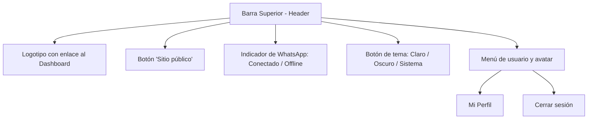
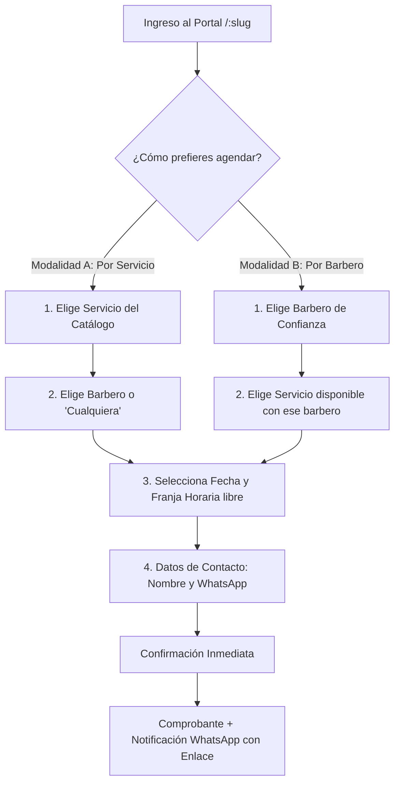
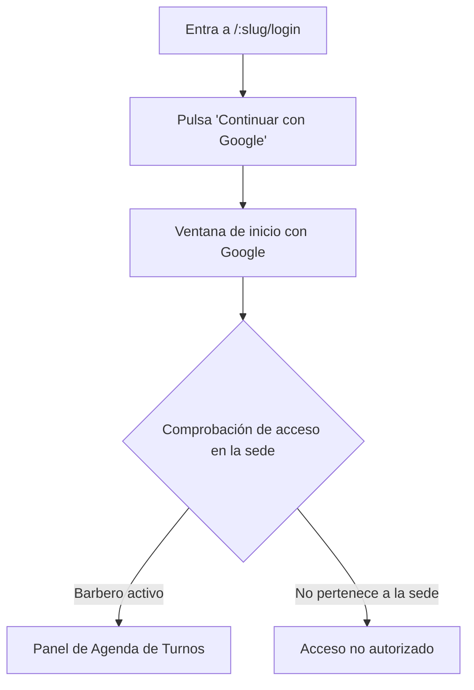
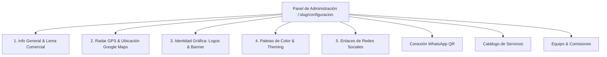
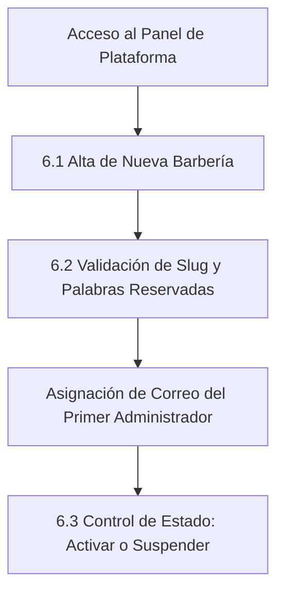

# 📖 Manual de Usuario del Sistema — Barbería VIP SaaS
### Plataforma Multisede de Gestión de Barberías y Agendamiento en Línea

> **Producto:** Barbería VIP SaaS (Versión Backend: `0.0.1` en `package.json` | Versión Frontend: `0.0.0` en `package.json`)  
> **Documento:** Manual de Usuario del Sistema — Versión 2.1.0  
> **Fecha de Emisión:** Noviembre 2026  
> **Emisor:** [Equipo / institución]  
> **Normas de Referencia:** ISO/IEC/IEEE 26514:2022 (Vigente) | IEEE Std 1063-2001 (Antecedente, reemplazada)  
> **Estado del Documento:** En revisión  
> **Idioma:** Español (`es-CO`)

---

## 📑 Tabla de Contenidos

1. [Información general y objetivos del sistema](#1-información-general-y-objetivos-del-sistema)
   * [1.1 Cómo usar este manual](#11-cómo-usar-este-manual)
2. [Requisitos de acceso y compatibilidad](#2-requisitos-de-acceso-y-compatibilidad)
   * [2.1 Navegadores compatibles](#21-navegadores-compatibles)
   * [2.2 Conexión y dispositivos](#22-conexión-y-dispositivos)
   * [2.3 Uso general de la interfaz](#23-uso-general-de-la-interfaz)
3. [Módulo 1: Experiencia del cliente e invitado (Portal público)](#3-módulo-1-experiencia-del-cliente-e-invitado-portal-público)
   * [3.1 Acceso al portal de la barbería](#31-acceso-al-portal-de-la-barbería)
   * [3.2 Exploración del catálogo y radar GPS](#32-exploración-del-catálogo-y-radar-gps)
   * [3.3 Procedimiento: Agendar una cita online (Doble modalidad)](#33-procedimiento-agendar-una-cita-online-doble-modalidad)
   * [3.4 Comprobante digital y confirmación por WhatsApp](#34-comprobante-digital-y-confirmación-por-whatsapp)
   * [3.5 Procedimiento: Consultar y cancelar cita con enlace corto](#35-procedimiento-consultar-y-cancelar-cita-con-enlace-corto)
   * [3.6 Procedimiento: Pedir un producto por WhatsApp](#36-procedimiento-pedir-un-producto-por-whatsapp)
   * [3.7 Portal del cliente registrado ("Mi cuenta")](#37-portal-del-cliente-registrado-mi-cuenta)
4. [Módulo 2: Operatoria del barbero (Staff)](#4-módulo-2-operatoria-del-barbero-staff)
   * [4.1 Procedimiento: Iniciar sesión en la sede con Google](#41-procedimiento-iniciar-sesión-en-la-sede-con-google)
   * [4.2 Consulta de agenda diaria y semanal](#42-consulta-de-agenda-diaria-y-semanal)
   * [4.3 Procedimiento: Cambiar el estado de una cita (Completar o No Asistió)](#43-procedimiento-cambiar-el-estado-de-una-cita-completar-o-no-asistió)
   * [4.4 Procedimiento: Bloquear horario personal o descanso](#44-procedimiento-bloquear-horario-personal-o-descanso)
5. [Módulo 3: Administración de la barbería (Dueño / Administrador)](#5-módulo-3-administración-de-la-barbería-dueño-administrador)
   * [5.1 Configuración integral del perfil de la barbería](#51-configuración-integral-del-perfil-de-la-barbería)
   * [5.2 Procedimiento: Crear y gestionar servicios](#52-procedimiento-crear-y-gestionar-servicios)
   * [5.3 Procedimiento: Crear y gestionar barberos y comisiones](#53-procedimiento-crear-y-gestionar-barberos-y-comisiones)
   * [5.4 Procedimiento: Gestionar catálogo de productos comerciales](#54-procedimiento-gestionar-catálogo-de-productos-comerciales)
   * [5.5 Procedimiento: Vincular WhatsApp mediante código QR](#55-procedimiento-vincular-whatsapp-mediante-código-qr)
   * [5.6 Personalización de plantillas, variables y anticipación](#56-personalización-de-plantillas-variables-y-anticipación)
   * [5.7 Procedimiento: Registrar reserva administrativa en mostrador (Walk-in)](#57-procedimiento-registrar-reserva-administrativa-en-mostrador-walk-in)
   * [5.8 Tablero de control y métricas del negocio (Dashboard)](#58-tablero-de-control-y-métricas-del-negocio-dashboard)
6. [Módulo 4: Superadministración de la plataforma](#6-módulo-4-superadministración-de-la-plataforma)
   * [6.1 Procedimiento: Alta de una nueva barbería (Sede)](#61-procedimiento-alta-de-una-nueva-barbería-sede)
   * [6.2 Reglas de validación y lista de identificadores reservados (Slugs)](#62-reglas-de-validación-y-lista-de-identificadores-reservados-slugs)
   * [6.3 Procedimiento: Cambiar el estado operativo de una barbería](#63-procedimiento-cambiar-el-estado-operativo-de-una-barbería)
7. [Errores del sistema y solución de problemas](#7-errores-del-sistema-y-solución-de-problemas)
   * [7.1 Tabla de mensajes de error de la interfaz](#71-tabla-de-mensajes-de-error-de-la-interfaz)
   * [7.2 Preguntas frecuentes (FAQ)](#72-preguntas-frecuentes-faq)
8. [Glosario](#8-glosario)
9. [Fuentes relacionadas](#9-fuentes-relacionadas)
10. [Historial de cambios](#10-historial-de-cambios)
11. [Registro de revisión](#11-registro-de-revisión)

---

## 1. Información general y objetivos del sistema

**Barbería VIP SaaS** es una solución web diseñada para organizar y optimizar las operaciones diarias de barberías independientes y cadenas de salones.

El sistema atiende dos necesidades operativas principales:
1. **Para los clientes:** Permite reservar citas en menos de un minuto desde cualquier teléfono móvil o computadora, sin necesidad de instalar aplicaciones pesadas ni recordar contraseñas.
2. **Para el negocio:** Centraliza la agenda del equipo, evita la duplicidad de turnos sobre una misma franja horaria, calcula comisiones de barberos y automatiza el envío de recordatorios y confirmaciones mediante WhatsApp.

### Estructura multisede (Multi-Tenant)
El sistema opera bajo un esquema multisede. Cada barbería cuenta con un espacio independiente identificado por un nombre exclusivo en la dirección web denominado **Slug** (por ejemplo: `barberia-elite`, `the-king-cut`). Los datos, reservas, clientes y configuraciones de una sede se mantienen completamente separados y nunca son accesibles por otra barbería.

---

### 1.1 Cómo usar este manual

Este manual está organizado según tu rol dentro de la plataforma. Para consultar directamente los procedimientos que te corresponden, localiza tu perfil en la siguiente tabla:

| Si eres... | Tu objetivo principal | Lee la sección |
| :--- | :--- | :---: |
| **Cliente o Invitado** | Agendar una cita, consultar el catálogo, cancelar un turno o pedir productos. | **[Sección 3](#3-módulo-1-experiencia-del-cliente-e-invitado-portal-público)** |
| **Barbero (Staff)** | Consultar tu agenda de turnos diaria y semanal, marcar citas y bloquear descansos. | **[Sección 4](#4-módulo-2-operatoria-del-barbero-staff)** |
| **Administrador de Sede** | Configurar horarios, servicios, barberos, comisiones, vincular WhatsApp y registrar reservas en mostrador. | **[Sección 5](#5-módulo-3-administración-de-la-barbería-dueño-administrador)** |
| **Superadministrador** | Dar de alta nuevas sedes, asignar identificadores web (slugs) y gestionar membresías globales. | **[Sección 6](#6-módulo-4-superadministración-de-la-plataforma)** |
| **Cualquier usuario** | Resolver dudas comunes, incidencias técnicas o consultar términos desconocidos. | **[Secciones 7 y 8](#7-errores-del-sistema-y-solución-de-problemas)** |

#### Convenciones tipográficas y notas de aviso
A lo largo del documento encontrarás las siguientes convenciones visuales:
* **Elementos de la interfaz:** Los nombres de botones, pestañas, menús y opciones aparecen siempre en **Negrita** (por ejemplo: pulsa **Confirmar Reserva** o entra a **Configuración**).
* **Rutas y valores técnicos:** Las direcciones web, identificadores y valores exactos se muestran en formato de código (por ejemplo: `/:slug/reservar`).
* ℹ️ **Información:** Aporta contexto operativo adicional útil para completar una tarea.
* ⚠️ **Importante / Advertencia:** Señala requisitos indispensables o acciones sensibles que liberan turnos o modifican datos. **En este manual, toda advertencia aparece siempre antes del paso al que afecta.**

---

## 2. Requisitos de acceso y compatibilidad

### 2.1 Navegadores compatibles
La plataforma funciona directamente en el navegador web de dispositivos móviles y de escritorio sin requerir descargas adicionales:
* **Google Chrome:** Versión 110 o superior (Recomendado).
* **Mozilla Firefox:** Versión 110 o superior.
* **Apple Safari (iOS / macOS):** Versión 15 o superior.
* **Microsoft Edge:** Versión 110 o superior.

### 2.2 Conexión y dispositivos
* Conexión a Internet estable (mínimo 3G en teléfonos celulares o banda ancha en computadoras).
* Navegador con soporte activo de JavaScript y almacenamiento local activado.

---

### 2.3 Uso general de la interfaz

La interfaz de Barbería VIP SaaS está estructurada de forma uniforme para facilitar la navegación en cualquier pantalla:

#### 1. Barra superior (Encabezado)
Disponible en la parte superior de todas las pantallas administrativas:
* **Logotipo de la sede:** Al pulsar sobre él, regresas de inmediato al panel principal (**Dashboard**).
* **Menú hamburguesa (en celulares y pantallas táctiles):** Abre y cierra la barra lateral de navegación.
* **Enlace a "Sitio público":** Abre el portal que ven los clientes finales para verificar en vivo los cambios en el catálogo.
* **Identidad del usuario:** Muestra tu nombre, apellido y etiqueta de rol activo.
* **Menú de usuario y avatar:** Al pulsar sobre tu fotografía o iniciales, se despliega un menú con accesos rápidos a **Mi Perfil**, **Sitio público** y la opción para **Cerrar sesión**.

#### 2. Cambio de tema claro / oscuro
La plataforma cuenta con tres modos de visualización:
1. Pulsa el botón con el ícono de sol, luna o monitor en el encabezado (o dentro del menú de usuario en teléfonos móviles).
2. Cada pulsación alterna secuencialmente entre:
   * **Modo Claro:** Fondo blanco con contrastes oscuros.
   * **Modo Oscuro:** Fondo oscuro para descansar la vista en entornos de baja iluminación.
   * **Seguir Sistema:** Se adapta automáticamente a la configuración visual de tu dispositivo.

#### 3. Selector de idioma
La interfaz opera de manera nativa y predeterminada en idioma español (`es-CO`). Actualmente no existe un selector dinámico de cambio de idioma en pantalla `[CONFIRMAR: selector de idioma multilingüe planificado para futuras versiones]`.

#### 4. Indicador "WhatsApp offline" (Estado de conexión)
En el encabezado de los administradores se muestra un indicador de salud del servicio de mensajería:
* **Insignia verde "WhatsApp":** Indica que el teléfono de la barbería está sincronizado y las confirmaciones automáticas están activas.
* **Insignia roja "WhatsApp offline":** Aparece cuando el teléfono de la sede pierde señal, se cierra la sesión en el móvil o falla la conexión.  
  * **Qué significa:** Los recordatorios automáticos de citas y las confirmaciones por mensaje quedan temporalmente pausados.
  * **Qué debes hacer:** Pulsa directamente sobre el botón rojo **WhatsApp offline**; el sistema te llevará a la pantalla de vinculación para generar un nuevo código QR y restablecer el servicio.

#### 5. Cerrar sesión de forma segura
Para finalizar tu turno de trabajo en computadoras compartidas:
1. Pulsa sobre tu avatar en la esquina superior derecha.
2. Selecciona la opción **Cerrar sesión**.
3. El sistema te mostrará un mensaje de confirmación: *«¿Estás seguro de que deseas salir del panel de administración?»*.
4. Pulsa **Cerrar sesión** para confirmar. Tus claves temporales de acceso se eliminarán del navegador y volverás a la pantalla de ingreso.

#### 6. Comportamiento en dispositivos móviles y tabletas
En pantallas pequeñas (ancho inferior a 992 píxeles):
* La barra lateral izquierda se oculta automáticamente para dar prioridad al contenido.
* Pulsa el botón de tres líneas horizontales (menú hamburguesa) para abrir el menú de opciones.
* Los botones y listas están optimizados con zonas de toque amplias (mínimo 44 píxeles) para facilitar la pulsación con los dedos.

---

## 3. Módulo 1: Experiencia del cliente e invitado (Portal público)

### 3.1 Acceso al portal de la barbería
Entra directamente mediante la dirección web oficial de la barbería:
`https://<dominio>/:slug` `[CONFIRMAR: dominio base de producción]`

> *Ejemplo:* Si el negocio se llama "Barbería Elite", su dirección web será `https://<dominio>/barberia-elite`.

---

### 3.2 Exploración del catálogo y radar GPS
Al entrar al portal de la barbería encuentras:
1. **Encabezado comercial:** Logotipo, nombre de la sede, horario de atención general y frase de bienvenida.
2. **Radar GPS y mapa de ubicación:** Mapa interactivo con la ubicación exacta de la sede y un botón para abrir la ruta guiada en **Google Maps** o **Waze**.
3. **Enlaces a redes sociales:** Accesos directos a los canales oficiales de Instagram, Facebook, TikTok y WhatsApp de la barbería.
4. **Catálogo de servicios:** Lista de servicios disponibles con foto, duración estimada en minutos y precio en moneda local ($ COP).
5. **Equipo de barberos:** Galería del equipo con especialidad y botón directo de reserva individual.

---

### 3.3 Procedimiento: Agendar una cita online (Doble modalidad)

* **Quién:** Clientes e invitados que visitan el portal público.
* **Antes de empezar:** Debes disponer de un número de teléfono móvil con WhatsApp activo para recibir el comprobante.

#### Pasos para agendar iniciando por servicio (Modalidad A):
1. En la página principal de la sede, localiza el servicio deseado en el catálogo y pulsa sobre su tarjeta.
2. En la parte inferior, pulsa el botón **Continuar**.
3. En la lista de profesionales, pulsa sobre el barbero de tu preferencia o selecciona la tarjeta **Cualquier Profesional** si deseas ver mayor cantidad de horarios.
4. En el calendario, pulsa sobre el día deseado.
5. En la cuadrícula de horas disponibles, pulsa sobre la franja horaria de tu preferencia (ejemplo: `14:00`).
6. En el formulario final, completa tus datos de contacto:
   * Escribe tu **Nombre** (obligatorio).
   * Escribe tu **Apellido** (opcional).
   * Escribe tu número de **Teléfono / WhatsApp** (obligatorio).
   * Escribe **Notas adicionales** (opcional).
7. ⚠️ **Advertencia:** Asegúrate de que el número de teléfono sea correcto, ya que allí recibirás el único enlace para cancelar o gestionar tu cita.
8. Pulsa el botón **Confirmar Reserva**.

#### Pasos para agendar iniciando por barbero (Modalidad B):
1. En la página principal, baja hasta la sección del equipo y pulsa el botón **Reservar con este Barbero**.
2. El sistema fija al profesional. Pulsa sobre uno de los servicios que él tiene asignados.
3. Elige la fecha en el calendario y pulsa la hora deseada.
4. Completa tus datos de contacto y pulsa **Confirmar Reserva**.

* **Resultado:** Se muestra de inmediato la pantalla de éxito con tu comprobante digital y tu código de reserva. Paralelamente, recibes un mensaje en tu WhatsApp con los datos del turno y tu enlace directo de gestión.
* **Si algo falla:** Si recibes el mensaje *"El horario seleccionado ya no está disponible"*, consulta la [Sección 7.1](#71-tabla-de-mensajes-de-error-de-la-interfaz) para seleccionar otra franja horaria.

#### Campos del formulario de reserva del cliente:
| Campo | Obligatorio | Formato o límite | Ejemplo |
| :--- | :---: | :--- | :--- |
| **Servicio** | Sí | Selección de un servicio activo | `Corte Clásico` |
| **Barbero** | Sí | Selección de un profesional o "Cualquiera" | `Carlos Gómez` |
| **Fecha** | Sí | Formato `AAAA-MM-DD`, día de calendario futuro | `2026-11-20` |
| **Hora** | Sí | Formato `HH:mm` (24 horas), bloque disponible | `14:00` |
| **Nombre** | Sí (invitado) | Texto alfanumérico, máx. 100 caracteres | `Juan` |
| **Apellido** | No | Texto alfanumérico, máx. 100 caracteres | `Pérez` |
| **Teléfono** | Sí (invitado) | Solo dígitos, entre 7 y 30 caracteres | `3001234567` |
| **Notas adicionales** | No | Texto libre descriptivo, máx. 250 caracteres | `Llegaré 5 minutos antes` |

---

### 3.4 Comprobante digital y confirmación por WhatsApp
Al confirmar tu turno:
1. **Pantalla de confirmación:** Visualizas en pantalla el comprobante digital con tu código de cita, servicio, barbero, fecha, hora y dirección física.
2. **Mensaje automático de WhatsApp:** Recibes en tu teléfono un mensaje con el saludo de la barbería, los detalles de tu cita y un enlace directo de autoservicio.

---

### 3.5 Procedimiento: Consultar y cancelar cita con enlace corto

* **Quién:** Clientes que recibieron su enlace de WhatsApp o que tienen el token de reserva.
* **Antes de empezar:** Debes abrir el enlace que llegó a tu WhatsApp desde tu teléfono o navegador web.

#### Pasos:
1. Abre el mensaje de confirmación en tu aplicación de WhatsApp.
2. Pulsa sobre el enlace corto de gestión:  
   `https://<dominio>/:slug/c/:id/:token` `[CONFIRMAR: dominio base de producción]`
3. Se abrirá la pantalla con los detalles de tu reserva (estado, barbero, fecha y hora).
4. Si necesitas cancelar, localiza la sección de gestión en la parte inferior.
5. ⚠️ **Advertencia:** La cancelación es irreversible. Una vez cancelada, la franja horaria queda libre inmediatamente para otros clientes. Además, no podrás cancelar si falta menos tiempo del fijado por la política de la barbería (por ejemplo: menos de 2 horas antes de la cita).
6. Pulsa el botón **Cancelar Cita**.
7. En el diálogo de confirmación que aparece, pulsa **Confirmar Cancelación**.

* **Resultado:** La pantalla se actualiza mostrando la insignia de estado **Cancelada** y el horario queda liberado en la agenda del barbero.
* **Si algo falla:** Si recibes el mensaje *"No es posible cancelar la reserva: faltan menos de X minutos para la cita"*, significa que estás fuera de plazo. Consulta la [Sección 7.1](#71-tabla-de-mensajes-de-error-de-la-interfaz) para comunicarte directamente con la sede.

---

### 3.6 Procedimiento: Pedir un producto por WhatsApp

* **Quién:** Clientes y visitantes interesados en comprar artículos de la barbería.
* **Antes de empezar:** Debes tener instalada la aplicación de WhatsApp o tener acceso a WhatsApp Web en tu dispositivo.

#### Pasos:
1. En el portal de la sede, entra a la sección **Productos** (`/:slug/catalogo/productos`).
2. Explora la galería o escribe el nombre del artículo en la barra de búsqueda.
3. Pulsa sobre la tarjeta del producto o en el botón **Ver más** para leer la descripción y modo de uso.
4. Pulsa el botón **Pedir por WhatsApp**.
5. Se abrirá una conversación con el número oficial de la sede con un mensaje estructurado con el nombre del producto y su precio.
6. Pulsa el botón de enviar en WhatsApp para coordinar la entrega o retiro en el local con el administrador.

* **Resultado:** La conversación se inicia en tu WhatsApp con el mensaje estructurado listo para acordar el pago y entrega.
* **Si algo falla:** Si el enlace no abre WhatsApp, verifica que tu navegador tenga permisos para abrir enlaces de aplicaciones externas.

---

### 3.7 Portal del cliente registrado ("Mi cuenta")
Si agendas con frecuencia y prefieres no buscar enlaces en WhatsApp:
1. Entra a `https://<dominio>/:slug/cliente/mi-cuenta` e inicia sesión con tu cuenta de Google.
2. **Próximas citas:** Revisa tus citas pendientes y cancélalas si lo necesitas.
3. **Historial de servicios:** Consulta citas anteriores, fecha, barbero que te atendió y valor cancelado.

---

## 4. Módulo 2: Operatoria del barbero (Staff)

Este módulo describe las tareas de los profesionales en el área de atención.

### 4.1 Procedimiento: Iniciar sesión en la sede con Google

* **Quién:** Barberos activos y personal del establecimiento.
* **Antes de empezar:** Tu correo electrónico de Google debe haber sido registrado previamente por el administrador de la sede en la sección de personal.

#### Pasos:
1. Abre tu navegador web e ingresa a la dirección de tu barbería:  
   `https://<dominio>/:slug/login` `[CONFIRMAR: dominio base de producción]`
2. Asegúrate de estar en la pestaña **Personal / Staff**.
3. Pulsa el botón **Continuar con Google**.
4. En la ventana emergente de Google, selecciona o escribe tu cuenta de correo electrónico autorizada y tu contraseña de Google.
5. Concede los permisos de autenticación requeridos por Google.

* **Resultado:** El sistema valida tu membresía activa en la sede y te redirige automáticamente a tu panel de trabajo (`/:slug/dashboard` o `/:slug/reservas`).
* **Si algo falla:** Si recibes el mensaje *"Tu cuenta no tiene permiso para realizar esta acción"* o *"El usuario no tiene un perfil de barbero asociado"*, consulta la [Sección 7.1](#71-tabla-de-mensajes-de-error-de-la-interfaz) para que el administrador verifique tu correo en la sede.

---

### 4.2 Consulta de agenda diaria y semanal
En tu panel de trabajo dispones de un calendario interactivo:
* **Vista diaria:** Tus citas del día ordenadas cronológicamente con nombre del cliente y servicio.
* **Vista semanal:** Distribución de turnos en los próximos días para planificar tu semana.
* **Colores de estado:**
  * 🟡 **Pendiente / Confirmada:** Turno por atender.
  * 🟢 **Completada:** Servicio finalizado con éxito.
  * 🔴 **Cancelada:** Turno cancelado por el cliente o la administración.
  * ⚪ **Bloqueo Personal:** Horario fuera de servicio por descanso o permiso.

---

### 4.3 Procedimiento: Cambiar el estado de una cita (Completar o No Asistió)

* **Quién:** Barbero asignado a la cita o Administrador de la sede.
* **Antes de empezar:** La cita debe encontrarse en estado confirmado y corresponder a la fecha actual o una fecha pasada.

#### Pasos para marcar cita completada:
1. En tu agenda diaria, pulsa sobre la tarjeta de la cita que acabas de atender.
2. En el panel lateral de detalles de la reserva, revisa el servicio y el precio final.
3. Pulsa el botón **Marcar como Completada**.

#### Pasos para registrar inasistencia (No-Show):
1. ⚠️ **Advertencia:** Solo puedes marcar como inasistencia una cita si el cliente no se presentó y ya transcurrió el tiempo de tolerancia fijado por la barbería (por defecto, 15 minutos tras la hora de inicio pactada).
2. Pulsa sobre la cita en tu agenda.
3. Pulsa el botón **Marcar como No Asistió**.

* **Resultado:** La cita cambia inmediatamente su estado visual. Si fue marcada como completada, se acumula al cálculo de tus comisiones del período. Si fue marcada como inasistencia, queda registrada en auditoría sin generar comisiones.
* **Si algo falla:** Si la cita ya fue cancelada previamente, el sistema impedirá el cambio de estado con un mensaje de aviso.

---

### 4.4 Procedimiento: Bloquear horario personal o descanso

* **Quién:** Barbero activo.
* **Antes de empezar:** Debes conocer la fecha y franja horaria exacta de tu ausencia (almuerzo, cita personal, capacitación).

#### Pasos:
1. En tu pantalla de agenda, pulsa el botón **Bloquear Horario**.
2. En el formulario emergente, selecciona la **Fecha** del bloqueo.
3. Selecciona la **Hora de inicio** (formato `HH:mm`, alineada en múltiplos de hora laboral).
4. Selecciona la **Hora de fin** (debe ser estrictamente posterior a la hora de inicio).
5. Selecciona el **Motivo** en la lista desplegable:
   * `Personal` (asuntos privados).
   * `Médico` (cita de salud).
   * `Vacaciones` (días de descanso extendido).
   * `Otro` (cualquier otra causa justificada).
6. ⚠️ **Advertencia:** Asegúrate de no tener citas ya confirmadas con clientes en esa misma franja; de lo contrario, el sistema rechazará el bloqueo por solapamiento.
7. Escribe una nota breve en el campo **Notas** (opcional).
8. Pulsa el botón **Guardar Bloqueo**.

* **Resultado:** La franja horaria se visualiza en color gris en tu agenda y queda bloqueada para que ningún cliente pueda agendar en ella desde la web.
* **Si algo falla:** Si recibes el mensaje *"El horario seleccionado ya no está disponible"*, verifica que no existan citas activas en esa franja.

#### Campos del formulario de bloqueo de horario:
| Campo | Obligatorio | Formato o límite | Ejemplo |
| :--- | :---: | :--- | :--- |
| **Fecha (`date`)** | Sí | Formato `AAAA-MM-DD` | `2026-11-20` |
| **Hora de inicio (`startTime`)** | Sí | Formato `HH:mm`, entre 09:00 y 20:00 | `13:00` |
| **Hora de fin (`endTime`)** | Sí | Formato `HH:mm`, posterior al inicio | `14:00` |
| **Motivo (`reason`)** | No | `PERSONAL`, `MEDICAL`, `VACATION`, `OTHER` | `PERSONAL` |
| **Notas (`notes`)** | No | Texto libre, máx. 500 caracteres | `Almuerzo con familia` |

---

## 5. Módulo 3: Administración de la barbería (Dueño / Administrador)

### 5.1 Configuración integral del perfil de la barbería

* **Quién:** Superadministrador de la plataforma o Administrador asignado a la sede.
* **Antes de empezar:** Debes tener a mano la dirección física de la sede, las imágenes de logotipo en formatos válidos y los enlaces de redes sociales.

#### Pasos para actualizar información y ubicación:
1. En el menú de navegación lateral, entra a **Configuración** (`/:slug/configuracion`).
2. En la pestaña **General**, escribe el **Nombre comercial** y la **Frase principal (Lema)** de la barbería.
3. En la sección de ubicación, ingresa la **Dirección física**.
4. Para la geolocalización, copia el enlace de tu barbería desde Google Maps o Waze y pégalo en el campo **Enlace o Coordenadas de Google Maps**; el sistema extraerá automáticamente la latitud y longitud numéricas. También puedes escribir manualmente ambos valores numéricos.
5. Pulsa el botón **Guardar Cambios**.

#### Pasos para actualizar identidad gráfica y archivos:
1. Ve a la pestaña **Identidad Gráfica**.
2. ⚠️ **Advertencia:** Cumple los límites estrictos de archivo: el Favicon, el Logo Blanco y el Logo Negro deben ser archivos vectoriales SVG válidos (máximo 256 KB); el Banner debe ser una imagen PNG (máximo 2 MB).
3. Pulsa sobre el área de carga del recurso que deseas cambiar (**Favicon**, **Banner**, **Logo Blanco** o **Logo Negro**).
4. Selecciona el archivo en tu computadora y confirma la carga. La previsualización se actualizará en pantalla.

#### Pasos para cambiar el tema visual:
1. En la pestaña **Temas de Marca**, pulsa sobre una de las 6 paletas de color disponibles (`clasico-azul`, `cyber-lime`, `sunset-amber`, `midnight-cyan`, `crimson-velvet`, `monochrome-noir`).
2. El sistema aplica el cambio en tiempo real y lo guarda automáticamente.

#### Pasos para gestionar redes sociales:
1. En la sección **Redes Sociales**, pulsa **Agregar Red Social**.
2. Selecciona el tipo (`Instagram`, `TikTok`, `Facebook`, `WhatsApp` u `Otro`).
3. ⚠️ **Advertencia:** Si seleccionas `Otro`, es obligatorio escribir el nombre visible de la red. La dirección URL debe comenzar obligatoriamente con `https://`.
4. Pega la URL completa y pulsa **Guardar Red Social**. Puedes usar el interruptor de activación para ocultarla temporalmente del portal sin borrarla.

#### Campos del formulario de perfil y redes sociales:
| Campo | Obligatorio | Formato o límite | Ejemplo |
| :--- | :---: | :--- | :--- |
| **Nombre de la sede** | Sí | Texto, entre 2 y 150 caracteres | `Kyrios Barber Studio` |
| **Frase principal (Lema)** | No | Texto libre, máx. 200 caracteres | `Estilo y elegancia tradicional` |
| **Dirección** | No | Texto libre, máx. 200 caracteres | `Carrera 6 # 3-45, Popayán` |
| **Latitud GPS** | No (en par) | Decimal entre -90 y 90 | `2.4419` |
| **Longitud GPS** | No (en par) | Decimal entre -180 y 180 | `-76.6063` |
| **Favicon** | No | Archivo SVG válido, máx. 256 KB | `favicon.svg` |
| **Banner horizontal** | No | Archivo PNG válido, máx. 2 MB | `banner.png` |
| **Logo Blanco / Negro** | No | Archivo SVG válido, máx. 256 KB | `logo.svg` |
| **Tipo de red social** | Sí | `TIKTOK`, `FACEBOOK`, `INSTAGRAM`, `WHATSAPP`, `OTRO` | `INSTAGRAM` |
| **Nombre de la red** | Sí (solo si es OTRO) | Texto obligatorio para OTRO, máx. 80 caracteres | `Canal de Telegram` |
| **URL de red social** | Sí | Dirección web con protocolo `https://`, máx. 500 caracteres | `https://instagram.com/kyrios` |

---

### 5.2 Procedimiento: Crear y gestionar servicios

* **Quién:** Administrador de la sede o Superadministrador.
* **Antes de empezar:** Debes conocer el precio de venta y la duración en minutos del servicio.

#### Pasos para crear un servicio:
1. En el menú lateral, pulsa **Servicios** (`/:slug/servicios`).
2. Pulsa el botón **Nuevo Servicio**.
3. En el formulario, escribe el **Nombre del servicio** (mínimo 3, máximo 100 caracteres).
4. Escribe la **Descripción** detallada de lo que incluye el corte o tratamiento (máx. 500 caracteres).
5. Ingresa el **Precio ($ COP)** (número mayor o igual a 0).
6. Ingresa la **Duración en minutos** (número entero positivo, mínimo 1 minuto; recomendado múltiplos de 15 o 30).
7. En la lista de barberos, marca las casillas de los profesionales que están capacitados para realizar este servicio.
8. Pulsa el botón **Guardar Servicio**.

* **Resultado:** El nuevo servicio aparece en tu lista administrativa y queda visible de inmediato en el portal público de reservas.
* **Si algo falla:** Si falta el nombre o el precio es negativo, el sistema resaltará el campo en rojo.

#### Campos del formulario de servicios:
| Campo | Obligatorio | Formato o límite | Ejemplo |
| :--- | :---: | :--- | :--- |
| **Nombre** | Sí | Texto, entre 3 y 100 caracteres | `Corte Clásico y Barba` |
| **Descripción** | No | Texto descriptivo, máx. 500 caracteres | `Incluye lavado, perfilado y toalla caliente` |
| **Precio ($ COP)** | Sí | Número decimal o entero $\ge 0$ | `35000` |
| **Duración en minutos** | Sí | Número entero $\ge 1$ | `45` |
| **Foto del servicio** | No | URL o archivo de imagen | `/uploads/servicios/corte.jpg` |
| **Barberos habilitados** | No | Lista de IDs de barberos activos | `[1, 3]` |

---

### 5.3 Procedimiento: Crear y gestionar barberos y comisiones

* **Quién:** Administrador de la sede o Superadministrador.
* **Antes de empezar:** El barbero debe disponer de una cuenta de correo electrónico de Google activa para poder iniciar sesión.

#### Pasos para registrar un barbero:
1. En el menú lateral, pulsa **Barberos** (`/:slug/barberos`).
2. Pulsa el botón **Nuevo Barbero**.
3. Escribe el **Nombre** del barbero (solo letras y espacios, entre 2 y 50 caracteres).
4. Escribe el **Apellido** (solo letras y espacios, entre 2 y 50 caracteres).
5. Escribe su **Correo de Google** (formato de correo válido, máx. 255 caracteres).
6. Escribe su número de **Teléfono de contacto** (dígitos con o sin signo `+`, entre 7 y 15 caracteres).
7. Ingresa el **Porcentaje de comisión** pactado (número entre 0 y 100).
8. Pulsa el botón **Guardar Barbero**.
9. En la pestaña de **Horario Semanal**, configura qué días trabaja el barbero y sus horas de inicio y fin de turno.

* **Resultado:** El perfil del barbero queda creado en el sistema. El profesional ya puede ingresar a la plataforma mediante el botón **Continuar con Google** usando el correo registrado.
* **Si algo falla:** Si el correo ya pertenece a otro barbero en la misma sede, el sistema mostrará un aviso de conflicto.

#### Campos del formulario de registro de barbero:
| Campo | Obligatorio | Formato o límite | Ejemplo |
| :--- | :---: | :--- | :--- |
| **Nombre** | Sí | Solo letras y espacios, 2 a 50 caracteres | `Carlos` |
| **Apellido** | Sí | Solo letras y espacios, 2 a 50 caracteres | `Gómez` |
| **Correo electrónico** | Sí | Correo electrónico válido, máx. 255 caracteres | `carlos.barbero@gmail.com` |
| **Teléfono** | Sí | Formato telefónico `^\+?\d{7,15}$` | `+573001234567` |
| **Porcentaje de comisión**| Sí | Número entre 0 y 100 | `50` |
| **Foto de perfil** | No | URL o archivo de imagen | `/uploads/barberos/carlos.jpg` |

---

### 5.4 Procedimiento: Gestionar catálogo de productos comerciales

* **Quién:** Administrador de la sede o Superadministrador.
* **Antes de empezar:** Debes tener los datos del producto y su fotografía en tu computadora.

#### Pasos para registrar un producto:
1. En el menú lateral, pulsa **Productos** (`/:slug/productos`).
2. Pulsa el botón **Nuevo Producto**.
3. Escribe el **Nombre del producto** (único en la sede, máx. 100 caracteres).
4. Escribe la **Descripción** comercial (máx. 500 caracteres).
5. Ingresa el **Precio ($ COP)** (mayor a 0.01 y menor a 99.999.999,99; máximo 2 decimales).
6. ⚠️ **Advertencia:** La imagen debe ser un archivo en formato JPG, PNG o WEBP válido con un peso máximo de 5 MB.
7. Pulsa sobre el selector de archivos y carga la foto del artículo.
8. Pulsa el botón **Guardar Producto**.

* **Resultado:** El producto queda creado y se muestra en la pestaña de productos activos del panel y en el catálogo público (`/:slug/catalogo/productos`).
* **Si algo falla:** Si recibes el mensaje *"Ya existe un producto con este nombre en este negocio"*, cambia el nombre por uno distintivo. Si recibes *"La imagen debe ser un archivo JPG, PNG o WEBP válido de máximo 5 MB"*, reduce el peso de la imagen o cambia el formato.

#### Campos del formulario de productos:
| Campo | Obligatorio | Formato o límite | Ejemplo |
| :--- | :---: | :--- | :--- |
| **Nombre** | Sí | Texto único en la sede, máx. 100 caracteres | `Cera Modeladora Mate` |
| **Descripción** | No | Texto descriptivo, máx. 500 caracteres | `Fijación fuerte con aroma a madera` |
| **Precio ($ COP)** | Sí | Decimal entre 0.01 y 99.999.999,99 (máx. 2 decimales) | `45000` |
| **Fotografía** | No | Archivo JPG, PNG o WEBP de máx. 5 MB | `cera-mate.jpg` |

---

### 5.5 Procedimiento: Vincular WhatsApp mediante código QR

* **Quién:** Administrador de la sede o Superadministrador.
* **Antes de empezar:** Debes tener a mano el teléfono móvil físico que tiene la línea oficial de WhatsApp de la barbería, con batería y conexión a Internet.

#### Pasos:
1. En el menú lateral, pulsa **WhatsApp** (`/:slug/whatsapp`).
2. ⚠️ **Advertencia:** La vinculación conecta el número de tu teléfono con la plataforma. Mientras esté vinculado, los mensajes automáticos se enviarán desde esa línea. Si cierras la sesión en el celular, las notificaciones quedarán pausadas.
3. Pulsa el botón **Generar Código QR**. En pantalla aparecerá un código QR con actualización automática.
4. Toma el teléfono celular de la barbería y abre la aplicación WhatsApp.
5. Entra a **Ajustes** (en iPhone) o pulsa los **tres puntos verticales** (en Android).
6. Selecciona la opción **Dispositivos vinculados**.
7. Pulsa el botón **Vincular un dispositivo** y confirma tu huella o PIN si tu teléfono lo solicita.
8. Apunta la cámara del teléfono hacia la pantalla de tu computadora y escanea el código QR.
9. Espera unos segundos sin cerrar la ventana.

* **Resultado:** La pantalla web se actualiza mostrando una insignia verde **WhatsApp Conectado**, el indicador del encabezado cambia a verde y el sistema queda listo para enviar confirmaciones y recordatorios.
* **Si algo falla:** Si el código caduca antes de escanearlo, pulsa el botón **Generar nuevo código QR**.

---

### 5.6 Personalización de plantillas, variables y anticipación
En la misma pantalla de WhatsApp:
1. **Elige el estilo del mensaje:** Selecciona entre los estilos predefinidos **Moderno** (con emojis y formalidad amable), **Formal** o **Minimalista**.
2. **Variables dinámicas:** Puedes insertar etiquetas como `{cliente}`, `{servicio}`, `{barbero}`, `{fecha}`, `{hora}`, `{precio}` y `{ubicacion}`. El sistema las reemplazará automáticamente con los datos reales de cada reserva.
3. **Ventana de anticipación:** Configura con cuántos minutos u horas de antelación se enviará el recordatorio automático (por ejemplo: 60 minutos, 120 minutos o 24 horas antes del turno).
4. **Prueba y verificación:** Revisa la vista previa en el simulador de teléfono en pantalla y pulsa **Enviar Mensaje de Prueba** a tu número para verificar el resultado.

---

### 5.7 Procedimiento: Registrar reserva administrativa en mostrador (Walk-in)

* **Quién:** Administrador de la sede o Recepcionista con rol administrativo.
* **Antes de empezar:** El cliente debe estar presente en el local o en la línea telefónica indicando qué servicio solicita.

#### Pasos:
1. En el menú lateral, ve a **Reservas** y pulsa el botón **Nueva Reserva** (`/:slug/reservas/nueva`).
2. Selecciona el **Barbero** que atenderá el turno en la lista desplegable.
3. Selecciona el **Servicio** solicitado.
4. En el calendario, selecciona la **Fecha** de hoy (o la fecha acordada).
5. En la lista de horarios libres calculados por el sistema, pulsa sobre la **Hora de inicio** deseada.
6. En la sección de datos del cliente:
   * Escribe el **Nombre** del cliente (obligatorio).
   * Escribe el **Apellido** (opcional).
   * Escribe el número de **Teléfono móvil** (obligatorio).
   * Escribe el **Correo electrónico** (opcional).
7. ⚠️ **Advertencia:** Si el cliente tiene una reserva activa en ese mismo minuto con otro barbero o en la sede, el sistema rechazará la creación por duplicidad.
8. Pulsa el botón **Crear Reserva**.

* **Resultado:** La reserva queda registrada en el acto en estado confirmada, aparece en la agenda del barbero seleccionado y, si WhatsApp está conectado, se envía automáticamente el comprobante digital al teléfono del cliente.
* **Si algo falla:** Si recibes el mensaje *"El horario seleccionado ya no está disponible"*, selecciona otra franja de la lista.

#### Campos del formulario de reserva administrativa:
| Campo | Obligatorio | Formato o límite | Ejemplo |
| :--- | :---: | :--- | :--- |
| **Servicio (`servicioId`)** | Sí | Entero positivo, servicio activo | `2` |
| **Barbero (`barberoId`)** | Sí | Entero positivo, barbero activo capacitado | `1` |
| **Fecha (`fecha`)** | Sí | Formato estricto `AAAA-MM-DD` (ISO8601) | `2026-11-20` |
| **Hora (`hora`)** | Sí | Formato `HH:mm` (00:00 a 23:59) | `15:30` |
| **Nombre** | Sí | Texto, máx. 100 caracteres | `Andrés` |
| **Apellido** | No | Texto, máx. 100 caracteres | `Mejía` |
| **Teléfono** | Sí | Texto numérico, máx. 20 caracteres | `3159876543` |
| **Correo electrónico** | No | Formato de email válido, máx. 255 caracteres | `andres@gmail.com` |

---

### 5.8 Tablero de control y métricas del negocio (Dashboard)

El panel principal (`/:slug/dashboard`) es la herramienta de supervisión diaria del administrador:

#### Pasos para consultar métricas y liquidaciones:
1. Inicia sesión como administrador y entra a **Dashboard** (`/:slug/dashboard`).
2. En la parte superior, revisa los contadores de la jornada:
   * **Citas hoy:** Cantidad de clientes agendados para el día en curso.
   * **Citas completadas:** Turnos atendidos exitosamente.
   * **Inasistencias (No-Show):** Clientes que no asistieron.
   * **Ingresos brutos estimados:** Suma monetaria de los servicios atendidos.
3. En la sección de **Rendimiento de Barberos**, revisa la tabla de comisiones acumuladas por cada profesional para proceder a la liquidación periódica.
4. En la sección **Próximas Citas**, consulta la secuencia de turnos que están por llegar para organizar los sillones y la recepción.

---

## 6. Módulo 4: Superadministración de la plataforma

Este módulo describe los procedimientos para los propietarios de la plataforma SaaS para la gobernanza global de barberías.

### 6.1 Procedimiento: Alta de una nueva barbería (Sede)

* **Quién:** Superadministrador de la plataforma.
* **Antes de empezar:** Debes contar con el nombre comercial de la barbería, el identificador deseado (slug) y el correo electrónico de Google del dueño o primer administrador.

#### Pasos:
1. Ingresa a la interfaz de gestión de plataforma (`/plataforma`).
2. Pulsa el botón **Nueva Barbería**.
3. En el campo **Nombre oficial**, escribe el nombre comercial de la sede (entre 2 y 150 caracteres).
4. En el campo **Identificador web (Slug)**, escribe el nombre exclusivo en minúsculas y sin espacios que irá en la URL (entre 2 y 63 caracteres).
5. ⚠️ **Advertencia:** El identificador no puede coincidir con ninguna de las palabras reservadas del sistema (ver [Sección 6.2](#62-reglas-de-validación-y-lista-de-identificadores-reservados-slugs)) ni con otra barbería ya registrada.
6. En el campo **Zona horaria**, verifica que indique `America/Bogota` (o la zona horaria oficial del local).
7. En el campo **Dirección**, ingresa la ubicación o ciudad de la barbería.
8. En los campos de administración inicial:
   * Escribe el **Correo del Administrador** (debe ser una cuenta de Google activa).
   * Escribe el **Nombre** del administrador.
   * Escribe el **Apellido** del administrador.
9. Pulsa el botón **Crear Barbería**.

* **Resultado:** La sede se crea en estado `ACTIVO`. Se habilita de inmediato su portal público en `https://<dominio>/:slug` y el primer administrador queda facultado para ingresar mediante Google.
* **Si algo falla:** Si recibes un error de slug duplicado o inválido, revisa las reglas de la sección 6.2.

#### Campos del formulario de alta de barbería:
| Campo | Obligatorio | Formato o límite | Ejemplo |
| :--- | :---: | :--- | :--- |
| **Nombre oficial (`nombre`)** | Sí | Texto, entre 2 y 150 caracteres | `Kyrios Barber Norte` |
| **Identificador (`slug`)** | Sí | Minúsculas, números y guiones, 2 a 63 caracteres (`/^[a-z0-9]+(?:-[a-z0-9]+)*$/`) | `kyrios-norte` |
| **Zona horaria (`zonaHoraria`)**| No | Texto de zona horaria oficial (por defecto `America/Bogota`) | `America/Bogota` |
| **Dirección (`direccion`)** | No | Texto libre descriptivo | `Cra 9 # 15-20, Popayán` |
| **Correo del Administrador (`adminEmail`)** | No | Formato de correo electrónico válido | `dueno.kyrios@gmail.com` |
| **Nombre del Administrador (`adminNombre`)** | No | Texto libre | `Felipe` |
| **Apellido del Administrador (`adminApellido`)** | No | Texto libre | `Armero` |

---

### 6.2 Reglas de validación y lista de identificadores reservados (Slugs)

El identificador web (**Slug**) define la ruta pública de acceso al portal de la sede (`https://<dominio>/:slug`). Para garantizar la estabilidad del enrutamiento y la seguridad de la plataforma, aplican las siguientes reglas obligatorias:

1. **Formato admitido:** Solo letras minúsculas (`a-z`), números (`0-9`) y guiones sencillos (`-`). No se admiten espacios, mayúsculas, tildes ni caracteres especiales.
2. **Longitud:** Mínimo 2 caracteres y máximo 63 caracteres.
3. **Lista de palabras reservadas:** El sistema rechaza automáticamente cualquier intento de registrar un slug que coincida con las siguientes rutas internas del código fuente:
   * `login`
   * `sin-acceso`
   * `dashboard`
   * `mi-perfil`
   * `horarios`
   * `reservas`
   * `usuarios`
   * `barberos`
   * `servicios`
   * `productos`
   * `whatsapp`
   * `administradores`
   * `configuracion`
   * `cliente`
   * `catalogo`
   * `reservar`
   * `reserva`
   * `plataforma`
   * `explorar`
   * `c`
   * `api`

---

### 6.3 Procedimiento: Cambiar el estado operativo de una barbería

* **Quién:** Superadministrador de la plataforma.
* **Antes de empezar:** Identificar la barbería en la lista de sedes de la plataforma.

#### Pasos:
1. En la lista de barberías de la plataforma, localiza la sede sobre la que deseas actuar.
2. Pulsa en el menú de acciones de la fila y selecciona **Cambiar Estado**.
3. Selecciona el nuevo estado:
   * **`ACTIVO`:** La barbería opera con normalidad, su portal público está abierto y su personal puede gestionar turnos.
   * **`INACTIVO`:** La barbería se suspende de forma inmediata. Su portal público se deshabilita para nuevas reservas y se bloquea el acceso administrativo. Los datos históricos se conservan intactos.
4. ⚠️ **Advertencia:** Suspender una sede pausará de inmediato el envío de recordatorios automáticos por WhatsApp para todas las citas de ese establecimiento.
5. Pulsa el botón **Confirmar Cambio de Estado**.

* **Resultado:** La sede adopta su nuevo estado operativo inmediatamente.

---

## 7. Errores del sistema y solución de problemas

Esta sección consolida los mensajes exactos de error que emite la aplicación y la guía para resolverlos.

### 7.1 Tabla de mensajes de error de la interfaz

| Mensaje en pantalla | Código HTTP / Causa real en el código | Qué ocurrió y qué debes hacer |
| :--- | :---: | :--- |
| **"Tu cuenta no tiene permiso para realizar esta acción."** | `403 Forbidden` | Intentaste ingresar con una cuenta de Google que no pertenece a la sede activa (`:slug`) o no tiene el rol necesario. Verifica la URL en tu navegador y pide al administrador que verifique tu correo en la sede. |
| **"Tu sesión expiró. Inicia sesión nuevamente para continuar."** | `401 Unauthorized` | El tiempo de validez de tu acceso finalizó. Pulsa en el enlace de inicio de sesión e ingresa nuevamente con tu cuenta de Google. |
| **"No encontramos la información solicitada."** | `404 Not Found` | La reserva, barbero, servicio o producto consultado no existe o fue eliminado. Verifica el enlace o regresa al catálogo principal. |
| **"Ese horario o registro cambió y ya no está disponible. Actualiza la información e inténtalo de nuevo."** | `409 Conflict` | Ocurrió un conflicto de doble reserva: otro cliente confirmó la misma franja horaria una fracción de segundo antes. Selecciona otro bloque libre en el calendario. |
| **"El horario seleccionado ya no está disponible. Por favor selecciona otro horario"** | `DomainConflictException` (`SLOT_TAKEN`) | La franja horaria seleccionada ya fue ocupada por otra cita o bloqueada por descanso del barbero. Elige otro bloque. |
| **"Ya tienes una reserva registrada para este horario"** | `409 Conflict` (`DUPLICATE_OWN_RESERVATION`) | Como cliente, ya cuentas con una reserva activa en esa misma franja horaria. Cancela la cita anterior si deseas cambiarla. |
| **"No es posible cancelar la reserva: faltan menos de X minutos para la cita. Contacta directamente a la barbería."** | `409 Conflict` (`CANCELLATION_DEADLINE`) | Intentaste cancelar en línea superando el límite de anticipación permitido por la sede (por ejemplo: a menos de 2 horas). Comunícate directamente con la barbería por teléfono. |
| **"No es posible cancelar una reserva en estado COMPLETED / IN_PROGRESS"** | `409 Conflict` | El turno ya fue atendido o está en proceso en el sillón de atención. No es posible anularlo. |
| **"Los datos ingresados no son válidos."** | `400 Bad Request` | Uno o varios campos del formulario no cumplen con el formato o longitud requerida (ejemplo: fecha inválida o texto demasiado largo). Revisa los campos resaltados en rojo. |
| **"Para un cliente ocasional, el nombre y el teléfono son obligatorios"** | `400 Bad Request` | En la reserva administrativa, no seleccionaste un cliente registrado y dejaste vacío el nombre o el teléfono. Completa ambos campos. |
| **"La URL debe ser válida y usar HTTPS."** | `400 Bad Request` (`IsUrl`) | Al registrar una red social en el perfil de la barbería, escribiste una dirección sin el protocolo `https://` obligatorio. Corrige el enlace anteponiendo `https://`. |
| **"La imagen debe ser un archivo JPG, PNG o WEBP válido de máximo 5 MB"** | `400 Bad Request` | La foto del producto excede los 5 MB permitidos o no corresponde a un formato de imagen admitido. Reduce su tamaño o conviértela a JPG/PNG. |
| **"Ya existe un producto con este nombre en este negocio"** | `409 Conflict` | Intentaste crear un producto con un nombre que ya está en uso en tu sede. Escribe un nombre diferenciador. |
| **"Esta función no está disponible por el momento. Inténtalo de nuevo más tarde."** | `503 Service Unavailable` | El servidor o la base de datos están bajo mantenimiento temporal. Espera unos minutos y recarga la página. |
| **"No fue posible completar la solicitud. Inténtalo de nuevo más tarde."** | `500 / 502 / 504` | Error temporal de red o del servidor. Verifica tu conexión a Internet y vuelve a intentarlo. |

---

### 7.2 Preguntas frecuentes (FAQ)

### ❓ ¿Cómo recupero mi contraseña si la olvido?
* **Respuesta:** Barbería VIP SaaS utiliza inicio de sesión seguro con Google y no almacena contraseñas locales. Si tienes inconvenientes con tu contraseña, debes gestionarla directamente en tu cuenta de Google. Si el sistema te deniega el acceso, pide al administrador de la sede que verifique que tu correo esté registrado en el equipo.

### ❓ ¿Qué hacer si aparece el aviso "WhatsApp offline"?
* **Causa común:** El teléfono perdió la conexión a Internet o se cerró la sesión de WhatsApp en el dispositivo móvil.
* **Solución:**
  1. Pulsa sobre el botón rojo **WhatsApp offline** en el encabezado.
  2. Pulsa **Reconectar** o **Cerrar Sesión**.
  3. Genera un nuevo código QR y escanéalo con el teléfono móvil de la barbería.

### ❓ Un cliente dice que no encuentra turnos libres para hoy.
* **Causas posibles:**
  1. Todos los bloques de la jornada ya están ocupados.
  2. El barbero tiene configurado el día como día de descanso semanal.
  3. El barbero registró un bloqueo de horario personal durante esas horas.
* **Solución:** Revisa la agenda del barbero en la sección de horarios para verificar si quedan franjas o si puede habilitarse una extensión horaria.

### ❓ ¿Qué ocurre si dos clientes intentan reservar exactamente la misma hora al mismo tiempo?
* El sistema cuenta con control automático contra solapamientos en tiempo real. Quien pulse confirmar primero obtiene la cita; el segundo cliente recibe el mensaje informativo *"Ese horario o registro cambió y ya no está disponible"*, invitándolo a seleccionar otro horario libre. No existen citas duplicadas.

### ❓ El cliente cerró la ventana del navegador y no guardó el comprobante.
* El comprobante y el enlace de gestión directa fueron enviados de forma automática a su número de WhatsApp al momento de confirmar.

### ❓ Mensaje de error: "No tienes permiso para acceder a esta barbería" al iniciar sesión.
* **Causa:** Intentaste entrar con una cuenta de correo que pertenece a otra sucursal o utilizaste un enlace con un identificador web (`:slug`) diferente.
* **Solución:** Revisa la barra de direcciones de tu navegador para asegurarte de estar en la dirección web correspondiente a tu sede.

---

## 8. Glosario

* **Sede (Tenant):** Barbería o sucursal independiente dentro de la plataforma que cuenta con sus propios clientes, barberos, servicios, catálogo y configuración gráfica aislada.
* **Slug:** Identificador alfanumérico único que aparece en la dirección web para acceder directamente al portal de una sede (ejemplo: `barberia-elite` en `https://<dominio>/barberia-elite`).
* **Enlace de gestión:** Dirección web corta y segura que recibe el cliente por WhatsApp para consultar el estado de su cita o cancelarla con un solo toque sin requerir contraseña.
* **Token de gestión:** Clave digital única que acompaña al enlace de la cita para autorizar al cliente a gestionar su reserva de manera segura.
* **No-Show:** Estado formal del turno que indica que el cliente no asistió a su cita programada dentro del tiempo de tolerancia.
* **Superadministrador:** Rol de gobernanza general de la plataforma con facultades para crear nuevas sedes, asignar identificadores y auditar el sistema.
* **Administrador de Sede:** Dueño o encargado de la sucursal responsable de la gestión de precios, equipo de barberos, comisiones y vinculación de WhatsApp.
* **Barbero (Staff):** Profesional que presta los servicios en los sillones de atención, consulta su agenda y registra la finalización de los turnos.
* **Membresía:** Vínculo formal que asocia a un usuario con una sede y un rol determinado, controlando a qué barbería tiene permitido ingresar.
* **Walk-in (Cita en mostrador):** Reserva registrada directamente por el personal de recepción para un cliente que llega caminando a la sede o agenda por llamada telefónica.

---

## 9. Fuentes relacionadas

* **Documentación de arquitectura técnica:** [`docs/arc42/`](arc42/README.md) (Especificación de vistas de arquitectura bajo el marco Arc42).
* **Especificación interactiva de la API:** `/api/docs` (Contratos OpenAPI / Swagger en vivo para desarrolladores e integradores).
* **Guía técnica del repositorio:** [`README.md`](../README.md) (Instrucciones de despliegue, scripts y configuración del entorno).
* **Contacto de soporte técnico:** `[CONFIRMAR: Canal o correo oficial de soporte técnico]`.

---

## 10. Historial de cambios

| Versión | Fecha | Resumen de modificaciones | Autor / Responsable |
| :---: | :---: | :--- | :---: |
| **1.0.0** | Octubre 2026 | Versión inicial del manual para sedes individuales. | Equipo de Desarrollo |
| **2.0.0** | Noviembre 2026 | Adaptación integral a la arquitectura multisede (multitenant) con código QR de WhatsApp y doble modalidad de agendamiento. | Dirección de Arquitectura |
| **2.1.0** | Noviembre 2026 | Alineación integral con estándares ISO/IEC/IEEE 26514:2022 e IEEE Std 1063-2001: aplicación de plantilla uniforme en procedimientos (quién, antes de empezar, pasos, resultado, si algo falla), incorporación de tablas de campos de formularios con validaciones del código, tabla exhaustiva de errores del sistema, módulo de superadministración paso a paso y referencias a capturas visuales. | [Equipo / institución] |

---

## 11. Registro de revisión

| Fecha | Revisor | Alcance de la revisión | Resultado |
| :---: | :---: | :--- | :---: |
| — | — | Exactitud técnica contra la aplicación y código fuente | En blanco para registro de pruebas |
| — | — | Prueba de comprensión y usabilidad con lector externo | En blanco para registro de pruebas |

---

> **Fin del Manual de Usuario**  
> *Para asistencia técnica o reportes sobre la plataforma, consulta con el equipo de soporte técnico oficial.*
