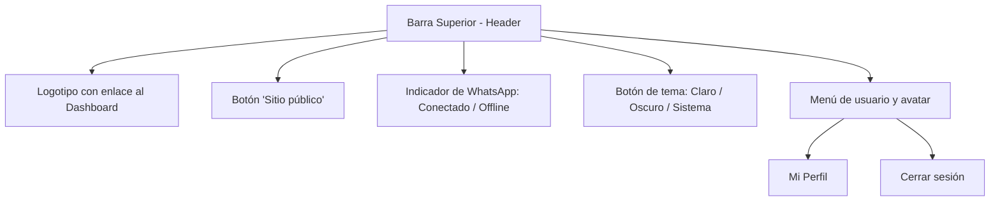
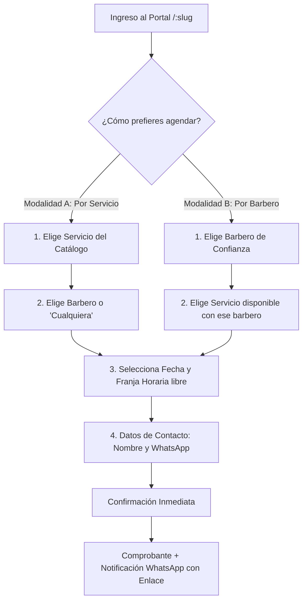
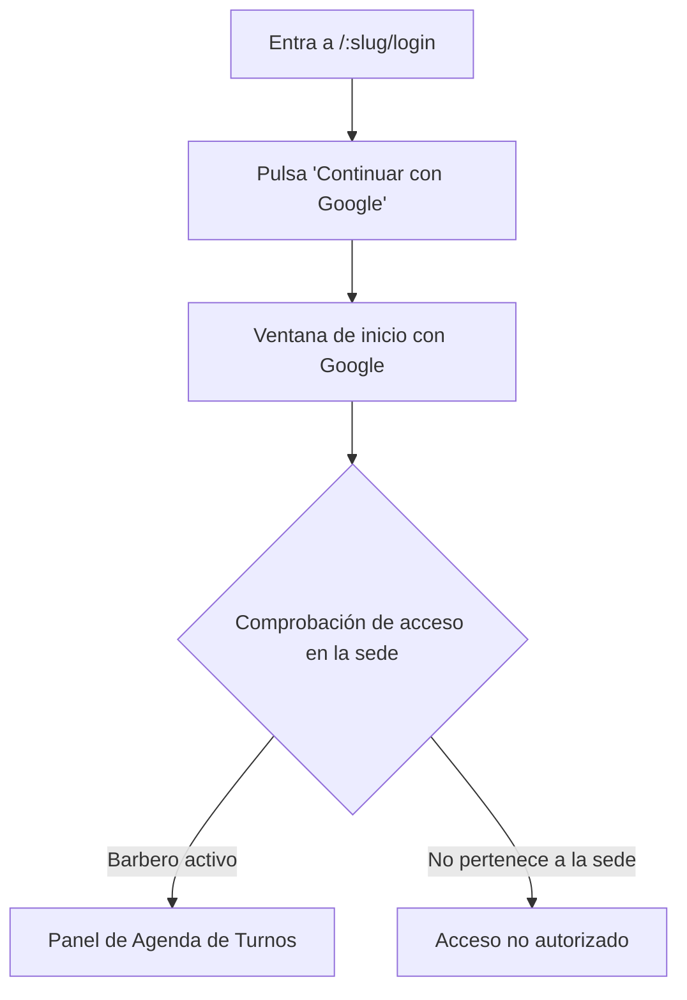
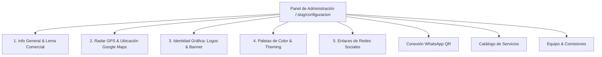
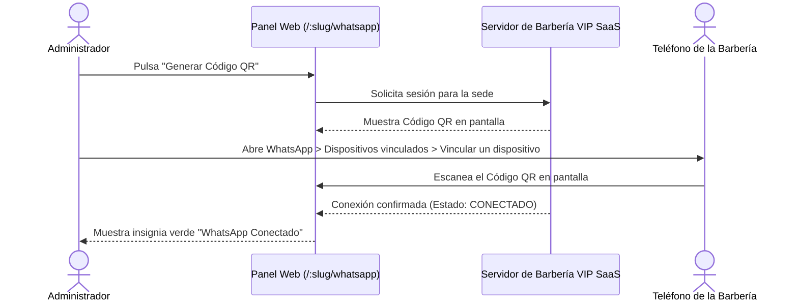

# 📖 Manual de Usuario del Sistema — Barbería VIP SaaS
### Plataforma Multisede de Gestión de Barberías y Agendamiento en Línea

> **Producto:** Barbería VIP SaaS (Versión Backend: `0.0.1` en `package.json` | Versión Frontend: `0.0.0` en `package.json`)  
> **Documento:** Manual de Usuario del Sistema — Versión 2.1.0  
> **Fecha de Emisión:** Noviembre 2026  
> **Emisor:** [Equipo / institución]  
> **Normas de Referencia:** ISO/IEC/IEEE 26514:2022 (Vigente) | IEEE Std 1063-2001 (Antecedente, reemplazada)  
> **Estado del Documento:** En revisión  
> **Idioma:** Español (`es-CO`)

---

## 📑 Tabla de Contenidos

1. [Información general y objetivos del sistema](#1-información-general-y-objetivos-del-sistema)
   * [1.1 Cómo usar este manual](#11-cómo-usar-este-manual)
2. [Requisitos de acceso y compatibilidad](#2-requisitos-de-acceso-y-compatibilidad)
   * [2.1 Navegadores compatibles](#21-navegadores-compatibles)
   * [2.2 Conexión y dispositivos](#22-conexión-y-dispositivos)
   * [2.3 Uso general de la interfaz](#23-uso-general-de-la-interfaz)
3. [Módulo 1: Experiencia del cliente e invitado (Portal público)](#3-módulo-1-experiencia-del-cliente-e-invitado-portal-público)
   * [3.1 Acceso al portal de la barbería](#31-acceso-al-portal-de-la-barbería)
   * [3.2 Exploración del catálogo y radar GPS](#32-exploración-del-catálogo-y-radar-gps)
   * [3.3 Flujo de agendamiento online (Doble modalidad)](#33-flujo-de-agendamiento-online-doble-modalidad)
   * [3.4 Comprobante digital y confirmación por WhatsApp](#34-comprobante-digital-y-confirmación-por-whatsapp)
   * [3.5 Consulta y cancelación de cita con enlace corto](#35-consulta-y-cancelación-de-cita-con-enlace-corto)
   * [3.6 Catálogo de productos y pedidos por WhatsApp](#36-catálogo-de-productos-y-pedidos-por-whatsapp)
   * [3.7 Portal del cliente registrado ("Mi cuenta")](#37-portal-del-cliente-registrado-mi-cuenta)
4. [Módulo 2: Operatoria del barbero (Staff)](#4-módulo-2-operatoria-del-barbero-staff)
   * [4.1 Inicio de sesión y acceso seguro (Inicio de sesión con Google)](#41-inicio-de-sesión-y-acceso-seguro-inicio-de-sesión-con-google)
   * [4.2 Consulta de agenda diaria y semanal](#42-consulta-de-agenda-diaria-y-semanal)
   * [4.3 Gestión de estados de cita (Completar / No-Show)](#43-gestión-de-estados-de-cita-completar-no-show)
   * [4.4 Bloqueo de horarios personales y descansos](#44-bloqueo-de-horarios-personales-y-descansos)
5. [Módulo 3: Administración de la barbería (Dueño / Administrador)](#5-módulo-3-administración-de-la-barbería-dueño-administrador)
   * [5.1 Configuración integral del perfil de la barbería (Superadmin y Administrador)](#51-configuración-integral-del-perfil-de-la-barbería-superadmin-y-administrador)
   * [5.2 Gestión del catálogo de servicios y precios](#52-gestión-del-catálogo-de-servicios-y-precios)
   * [5.3 Gestión del equipo de barberos y comisiones](#53-gestión-del-equipo-de-barberos-y-comisiones)
   * [5.4 Gestión del catálogo comercial de productos](#54-gestión-del-catálogo-comercial-de-productos)
   * [5.5 Vinculación de WhatsApp mediante código QR](#55-vinculación-de-whatsapp-mediante-código-qr)
   * [5.6 Personalización de plantillas, variables y anticipación](#56-personalización-de-plantillas-variables-y-anticipación)
   * [5.7 Agendamiento administrativo en mostrador (Walk-in / Llamadas)](#57-agendamiento-administrativo-en-mostrador-walk-in-llamadas)
   * [5.8 Tablero de control y métricas del negocio (Dashboard)](#58-tablero-de-control-y-métricas-del-negocio-dashboard)
6. [Módulo 4: Superadministración de la plataforma](#6-módulo-4-superadministración-de-la-plataforma)
7. [Guía de solución de problemas y preguntas frecuentes (FAQ)](#7-guía-de-solución-de-problemas-y-preguntas-frecuentes-faq)
8. [Glosario](#8-glosario)
9. [Fuentes relacionadas](#9-fuentes-relacionadas)
10. [Historial de cambios](#10-historial-de-cambios)
11. [Registro de revisión](#11-registro-de-revisión)

---

## 1. Información general y objetivos del sistema

**Barbería VIP SaaS** es una solución web diseñada para organizar y optimizar las operaciones diarias de barberías independientes y cadenas de salones.

El sistema atiende dos necesidades operativas principales:
1. **Para los clientes:** Permite reservar citas en menos de un minuto desde cualquier teléfono móvil o computadora, sin necesidad de instalar aplicaciones pesadas ni recordar contraseñas.
2. **Para el negocio:** Centraliza la agenda del equipo, evita la duplicidad de turnos sobre una misma franja horaria, calcula comisiones de barberos y automatiza el envío de recordatorios y confirmaciones mediante WhatsApp.

### Estructura multisede (Multi-Tenant)
El sistema opera bajo un esquema multisede. Cada barbería cuenta con un espacio independiente identificado por un nombre exclusivo en la dirección web denominado **Slug** (por ejemplo: `barberia-elite`, `the-king-cut`). Los datos, reservas, clientes y configuraciones de una sede se mantienen completamente separados y nunca son accesibles por otra barbería.

---

### 1.1 Cómo usar este manual

Este manual está organizado según tu rol dentro de la plataforma. Para consultar directamente los procedimientos que te corresponden, localiza tu perfil en la siguiente tabla:

| Si eres... | Tu objetivo principal | Lee la sección |
| :--- | :--- | :---: |
| **Cliente o Invitado** | Agendar una cita, consultar el catálogo, cancelar un turno o pedir productos. | **[Sección 3](#3-módulo-1-experiencia-del-cliente-e-invitado-portal-público)** |
| **Barbero (Staff)** | Consultar tu agenda de turnos diaria y semanal, marcar citas y bloquear descansos. | **[Sección 4](#4-módulo-2-operatoria-del-barbero-staff)** |
| **Administrador de Sede** | Configurar horarios, servicios, barberos, comisiones, vincular WhatsApp y registrar reservas en mostrador. | **[Sección 5](#5-módulo-3-administración-de-la-barbería-dueño-administrador)** |
| **Superadministrador** | Dar de alta nuevas sedes, asignar identificadores web (slugs) y gestionar membresías globales. | **[Sección 6](#6-módulo-4-superadministración-de-la-plataforma)** |
| **Cualquier usuario** | Resolver dudas comunes, incidencias técnicas o consultar términos desconocidos. | **[Secciones 7 y 8](#7-guía-de-solución-de-problemas-y-preguntas-frecuentes-faq)** |

#### Convenciones tipográficas y notas de aviso
A lo largo del documento encontrarás las siguientes convenciones visuales:
* **Elementos de la interfaz:** Los nombres de botones, pestañas, menús y opciones aparecen siempre en **Negrita** (por ejemplo: pulsa **Confirmar Reserva** o entra a **Configuración**).
* **Rutas y valores técnicos:** Las direcciones web, identificadores y valores exactos se muestran en formato de código (por ejemplo: `/:slug/reservar`).
* ℹ️ **Información:** Aporta contexto operativo adicional útil para completar una tarea.
* ⚠️ **Importante / Advertencia:** Señala requisitos indispensables o acciones sensibles que liberan turnos o modifican datos.

---

## 2. Requisitos de acceso y compatibilidad

### 2.1 Navegadores compatibles
La plataforma funciona directamente en el navegador web de dispositivos móviles y de escritorio sin requerir descargas adicionales:
* **Google Chrome:** Versión 110 o superior (Recomendado).
* **Mozilla Firefox:** Versión 110 o superior.
* **Apple Safari (iOS / macOS):** Versión 15 o superior.
* **Microsoft Edge:** Versión 110 o superior.

### 2.2 Conexión y dispositivos
* Conexión a Internet estable (mínimo 3G en teléfonos celulares o banda ancha en computadoras).
* Navegador con soporte activo de JavaScript y almacenamiento local activado.

---

### 2.3 Uso general de la interfaz

La interfaz de Barbería VIP SaaS está estructurada de forma uniforme para facilitar la navegación en cualquier pantalla:

#### 1. Barra superior (Encabezado)
Disponible en la parte superior de todas las pantallas administrativas:
* **Logotipo de la sede:** Al pulsar sobre él, regresas de inmediato al panel principal (**Dashboard**).
* **Menú hamburguesa (en celulares y pantallas táctiles):** Abre y cierra la barra lateral de navegación.
* **Enlace a "Sitio público":** Abre el portal que ven los clientes finales para verificar en vivo los cambios en el catálogo.
* **Identidad del usuario:** Muestra tu nombre, apellido y etiqueta de rol activo.
* **Menú de usuario y avatar:** Al pulsar sobre tu fotografía o iniciales, se despliega un menú con accesos rápidos a **Mi Perfil**, **Sitio público** y la opción para **Cerrar sesión**.

#### 2. Cambio de tema claro / oscuro
La plataforma cuenta con tres modos de visualización:
1. Pulsa el botón con el ícono de sol, luna o monitor en el encabezado (o dentro del menú de usuario en teléfonos móviles).
2. Cada pulsación alterna secuencialmente entre:
   * **Modo Claro:** Fondo blanco con contrastes oscuros.
   * **Modo Oscuro:** Fondo oscuro para descansar la vista en entornos de baja iluminación.
   * **Seguir Sistema:** Se adapta automáticamente a la configuración visual de tu dispositivo.

#### 3. Selector de idioma
La interfaz opera de manera nativa y predeterminada en idioma español (`es-CO`). Actualmente no existe un selector dinámico de cambio de idioma en pantalla `[CONFIRMAR: selector de idioma multilingüe planificado para futuras versiones]`.

#### 4. Indicador "WhatsApp offline" (Estado de conexión)
En el encabezado de los administradores se muestra un indicador de salud del servicio de mensajería:
* **Insignia verde "WhatsApp":** Indica que el teléfono de la barbería está sincronizado y las confirmaciones automáticas están activas.
* **Insignia roja "WhatsApp offline":** Aparece cuando el teléfono de la sede pierde señal, se cierra la sesión en el móvil o falla la conexión.  
  * **Qué significa:** Los recordatorios automáticos de citas y las confirmaciones por mensaje quedan temporalmente pausados.
  * **Qué debes hacer:** Pulsa directamente sobre el botón rojo **WhatsApp offline**; el sistema te llevará a la pantalla de vinculación para generar un nuevo código QR y restablecer el servicio.

#### 5. Cerrar sesión de forma segura
Para finalizar tu turno de trabajo en computadoras compartidas:
1. Pulsa sobre tu avatar en la esquina superior derecha.
2. Selecciona la opción **Cerrar sesión**.
3. El sistema te mostrará un mensaje de confirmación: *«¿Estás seguro de que deseas salir del panel de administración?»*.
4. Pulsa **Cerrar sesión** para confirmar. Tus claves temporales de acceso se eliminarán del navegador y volverás a la pantalla de ingreso.

#### 6. Comportamiento en dispositivos móviles y tabletas
En pantallas pequeñas (ancho inferior a 992 píxeles):
* La barra lateral izquierda se oculta automáticamente para dar prioridad al contenido.
* Pulsa el botón de tres líneas horizontales (menú hamburguesa) para abrir el menú de opciones.
* Los botones y listas están optimizados con zonas de toque amplias (mínimo 44 píxeles) para facilitar la pulsación con los dedos.

---

## 3. Módulo 1: Experiencia del cliente e invitado (Portal público)

### 3.1 Acceso al portal de la barbería
Entra directamente mediante la dirección web oficial de la barbería:
`https://<dominio>/:slug` `[CONFIRMAR: dominio base de producción]`

> *Ejemplo:* Si el negocio se llama "Barbería Elite", su dirección web será `https://<dominio>/barberia-elite`.

---

### 3.2 Exploración del catálogo y radar GPS
Al entrar al portal de la barbería encuentras:
1. **Encabezado comercial:** Logotipo, nombre de la sede, horario de atención general y frase de bienvenida.
2. **Radar GPS y mapa de ubicación:** Mapa interactivo con la ubicación exacta de la sede y un botón para abrir la ruta guiada en **Google Maps** o **Waze**.
3. **Enlaces a redes sociales:** Accesos directos a los canales oficiales de Instagram, Facebook, TikTok y WhatsApp de la barbería.
4. **Catálogo de servicios:** Lista de servicios disponibles con foto, duración estimada en minutos y precio en moneda local ($ COP).
5. **Equipo de barberos:** Galería del equipo con especialidad y botón directo de reserva individual.

---

### 3.3 Flujo de agendamiento online (Doble modalidad)

El asistente de reservas se adapta a tu preferencia mediante dos caminos:

#### 🔹 Modalidad A: Agendar iniciando por servicio
1. **Paso 1 (Servicio):** Pulsa sobre el servicio que deseas en el catálogo (por ejemplo: "Corte Clásico"). Pulsa el botón **Continuar**.
2. **Paso 2 (Barbero):** Elige a tu barbero preferido entre los habilitados para ese corte, o selecciona **Cualquier Profesional** para ver la mayor cantidad de horarios disponibles.
3. **Paso 3 (Fecha y hora):** Selecciona el día en el calendario y pulsa la hora deseada. Los bloques ocupados o en descanso no se muestran.
4. **Paso 4 (Datos y confirmación):** Escribe tu nombre, número de WhatsApp y notas adicionales si las requieres. Pulsa **Confirmar Reserva**.

#### 🔹 Modalidad B: Agendar iniciando por barbero
1. **Paso 1 (Profesional):** En la sección del equipo o perfil del barbero, pulsa el botón **Reservar con este Barbero**.
2. **Paso 2 (Servicio):** El sistema fija al profesional y te muestra únicamente los servicios que él realiza. Selecciona el servicio deseado.
3. **Paso 3 (Fecha y hora):** Elige el día y selecciona una franja libre de su agenda personal.
4. **Paso 4 (Datos y confirmación):** Ingresa tu nombre y número de WhatsApp y pulsa **Confirmar Reserva**.

---

### 3.4 Comprobante digital y confirmación por WhatsApp
Al confirmar tu turno:
1. **Pantalla de confirmación:** Visualizas en pantalla el comprobante digital con tu código de cita, servicio, barbero, fecha, hora y dirección física.
2. **Mensaje automático de WhatsApp:** Recibes en tu teléfono un mensaje con el saludo de la barbería, los detalles de tu cita y un enlace directo de autoservicio.

---

### 3.5 Consulta y cancelación de cita con enlace corto
No necesitas recordar contraseñas para administrar tu turno. El mensaje de WhatsApp incluye un enlace corto seguro:
`https://<dominio>/:slug/c/:id/:token` `[CONFIRMAR: dominio base de producción]`

* **Consultar estado:** Pulsa el enlace para verificar si tu cita está confirmada o en atención.
* **Cancelar cita:** Si tienes un imprevisto, pulsa el botón **Cancelar Cita**. El sistema libera de inmediato el horario para otros clientes y avisa al barbero.

> ℹ️ **Nota de cancelación:** Las cancelaciones están sujetas a la anticipación fijada por la barbería (por ejemplo: permitidas hasta con 2 horas de antelación al turno).

---

### 3.6 Catálogo de productos y pedidos por WhatsApp
Puedes consultar los artículos de cuidado personal en `/:slug/catalogo/productos`:
1. **Galería de productos:** Revisa productos (pomadas, aceites, champús) con foto, precio y descripción.
2. **Búsqueda rápida:** Escribe en la barra de búsqueda para filtrar por nombre en tiempo real.
3. **Botón "Pedir por WhatsApp":** Abre una conversación con el WhatsApp de la barbería con un mensaje predefinido con el nombre del producto y su precio para coordinar la compra.

---

### 3.7 Portal del cliente registrado ("Mi cuenta")
Si agendas con frecuencia y prefieres no buscar enlaces en WhatsApp:
1. Entra a `https://<dominio>/:slug/cliente/mi-cuenta` e inicia sesión con tu cuenta de Google.
2. **Próximas citas:** Revisa tus citas pendientes y cancélalas si lo necesitas.
3. **Historial de servicios:** Consulta citas anteriores, fecha, barbero que te atendió y valor cancelado.

---

## 4. Módulo 2: Operatoria del barbero (Staff)

Este módulo describe las tareas de los profesionales en el área de atención.

### 4.1 Inicio de sesión y acceso seguro (Inicio de sesión con Google)
La plataforma utiliza inicio de sesión seguro con Google. No necesitas crear contraseñas locales:
1. Entra a la dirección web de tu barbería: `https://<dominio>/:slug/login`.
2. En la pestaña de acceso, pulsa el botón **Continuar con Google**.
3. Selecciona tu cuenta de correo de Google registrada previamente por el administrador.
4. El sistema comprueba tu membresía activa en la sede y abre tu panel de agenda de turnos.

---

### 4.2 Consulta de agenda diaria y semanal
En tu panel de trabajo dispones de un calendario interactivo:
* **Vista diaria:** Tus citas del día ordenadas cronológicamente con nombre del cliente y servicio.
* **Vista semanal:** Distribución de turnos en los próximos días para planificar tu semana.
* **Colores de estado:**
  * 🟡 **Pendiente / Confirmada:** Turno por atender.
  * 🟢 **Completada:** Servicio finalizado con éxito.
  * 🔴 **Cancelada:** Turno cancelado por el cliente o la administración.
  * ⚪ **Bloqueo Personal:** Horario fuera de servicio por descanso o permiso.

---

### 4.3 Gestión de estados de cita (Completar / No-Show)
Al terminar una cita:
* **Completar servicio:** Pulsa **Marcar como Completada** al terminar la atención. Esto cierra el turno y suma el valor a tu liquidación de comisiones.
* **Cliente ausente (No-Show):** Si el cliente no se presenta tras el tiempo de tolerancia, pulsa **Marcar como No Asistió**. Esto registra la inasistencia sin generar comisiones erróneas.

---

### 4.4 Bloqueo de horarios personales y descansos
Si necesitas ausentarte en tu horario laboral (almuerzo, cita médica o descanso):
1. Pulsa el botón **Bloquear Horario** en tu agenda.
2. Selecciona la fecha, hora de inicio y hora de fin del bloqueo.
3. Escribe un motivo breve (por ejemplo: *"Almuerzo"*).
4. Pulsa **Guardar Bloqueo**. El horario quedará cerrado y ningún cliente podrá reservar en ese intervalo.

---

## 5. Módulo 3: Administración de la barbería (Dueño / Administrador)

### 5.1 Configuración integral del perfil de la barbería (Superadmin y Administrador)
Tanto el Superadministrador como el Administrador de la sede pueden configurar el perfil en `/:slug/configuracion`:
1. **Información general:** Edita el nombre comercial de la sede y el eslogan o frase principal de portada.
2. **Ubicación y mapa GPS:** Escribe la dirección física o pega directamente el enlace de Google Maps del local; el sistema extrae automáticamente la latitud y longitud para el botón del mapa público.
3. **Identidad visual:** Carga o reemplaza el Favicon (ícono de pestaña), el Banner de portada, el Logo para fondo oscuro (blanco) y el Logo para fondo claro (negro).
4. **Paleta de colores de la marca:** Elige entre 6 estilos visuales predefinidos (`clasico-azul`, `cyber-lime`, `sunset-amber`, `midnight-cyan`, `crimson-velvet`, `monochrome-noir`).
5. **Redes sociales:** Vincula los enlaces de Instagram, TikTok, Facebook y WhatsApp, y activa o desactiva canales según los necesites.

---

### 5.2 Gestión del catálogo de servicios y precios
En la sección **Servicios**:
* **Crear nuevo servicio:** Pulsa **Nuevo Servicio**, escribe el nombre, categoría, precio, duración en minutos y descripción.
* **Fotografía:** Sube una imagen demostrativa del corte o tratamiento.
* **Activar o pausar:** Puedes desactivar un servicio temporalmente sin eliminarlo ni afectar el historial de citas pasadas.

---

### 5.3 Gestión del equipo de barberos y comisiones
En la sección **Barberos**:
1. **Registrar barbero:** Pulsa **Nuevo Barbero**, escribe su nombre, correo de Google, especialidad y foto.
2. **Definir horario de trabajo:** Configura los días laborables de la semana, hora de inicio, hora de cierre y descansos.
3. **Porcentaje de comisión:** Asigna el porcentaje pactado con el barbero (por ejemplo: 45% o 50%). El sistema calculará automáticamente sus ingresos acumulados sobre los servicios completados.

---

### 5.4 Gestión del catálogo comercial de productos
En la sección **Productos**:
1. **Nuevo producto:** Pulsa **Nuevo Producto**, ingresa nombre comercial (máx. 100 caracteres), precio mayor a 0, fotografía (hasta 5 MB) y descripción (hasta 500 caracteres).
2. **Control de visibilidad:** Activa o desactiva productos según la disponibilidad de inventario físico.

---

### 5.5 Vinculación de WhatsApp mediante código QR
Para enviar confirmaciones y recordatorios desde la línea telefónica de la barbería:

1. Entra a **WhatsApp** (`/:slug/whatsapp`) en el menú administrativo.
2. Pulsa el botón **Generar Código QR**.
3. En el teléfono de la barbería, abre WhatsApp, entra a **Dispositivos vinculados** y pulsa **Vincular un dispositivo**.
4. Apunta la cámara del teléfono a la pantalla y escanea el código QR.
5. Al vincularse, la pantalla mostrará la insignia verde **WhatsApp Conectado**.

> ⚠️ **Importante:** El teléfono de la barbería debe mantener conexión a Internet para que los mensajes programados se sigan enviando de forma automática.

---

### 5.6 Personalización de plantillas, variables y anticipación
En la misma pantalla de WhatsApp:
1. **Elige el estilo del mensaje:** Selecciona entre los estilos predefinidos **Moderno** (con emojis y formalidad amable), **Formal** o **Minimalista**.
2. **Variables dinámicas:** Puedes insertar etiquetas como `{cliente}`, `{servicio}`, `{barbero}`, `{fecha}`, `{hora}`, `{precio}` y `{ubicacion}`. El sistema las reemplazará automáticamente con los datos reales de cada reserva.
3. **Ventana de anticipación:** Configura con cuántos minutos u horas de antelación se enviará el recordatorio automático (por ejemplo: 60 minutos, 120 minutos o 24 horas antes del turno).
4. **Prueba y verificación:** Revisa la vista previa en el simulador de teléfono en pantalla y pulsa **Enviar Mensaje de Prueba** a tu número para verificar el resultado.

---

### 5.7 Agendamiento administrativo en mostrador (Walk-in / Llamadas)
Para atender a clientes que llegan directamente al local o reservan por llamada telefónica:
1. Entra a **Reservas** y pulsa **Nueva Reserva** (`/:slug/reservas/nueva`).
2. Selecciona el barbero, el servicio, la fecha y una de las horas libres calculadas por el sistema.
3. Escribe el nombre y número de teléfono móvil del cliente.
4. Pulsa **Crear Reserva**. La franja queda bloqueada en el calendario y, si WhatsApp está conectado, el cliente recibe de inmediato su comprobante en el teléfono.

---

### 5.8 Tablero de control y métricas del negocio (Dashboard)
El panel principal (`/:slug/dashboard`) consolida los indicadores clave de la sede:
* **Citas del día y de la semana:** Total de citas agendadas, completadas y canceladas.
* **Control de ausencias (No-Show):** Porcentaje de inasistencias para evaluar la puntualidad de la clientela.
* **Liquidación de comisiones:** Rendimiento y valores acumulados por cada barbero según su porcentaje asignado.
* **Lista de próximas citas:** Secuencia de clientes programados para el día de hoy en recepción.

---

## 6. Módulo 4: Superadministración de la plataforma

Este módulo está destinado a los administradores generales del software multisede:
* **Alta de nuevas barberías:** Registro de nuevos establecimientos en el sistema y vinculación del correo de Google del primer administrador.
* **Asignación y validación de Slugs:** Comprobación de que el identificador web no colisione con nombres reservados del sistema (`admin`, `login`, `api`, `dashboard`).
* **Activación y suspensión de sedes:** Pausa de servicios por mantenimiento o gestión administrativa.

---

## 7. Guía de solución de problemas y preguntas frecuentes (FAQ)

### ❓ ¿Cómo recupero mi contraseña si la olvido?
* **Respuesta:** Barbería VIP SaaS utiliza inicio de sesión seguro con Google y no almacena contraseñas locales. Si tienes inconvenientes con tu contraseña, debes gestionarla directamente en tu cuenta de Google. Si el sistema te deniega el acceso, pide al administrador de la sede que verifique que tu correo esté registrado en el equipo.

### ❓ ¿Qué hacer si aparece el aviso "WhatsApp offline"?
* **Causa común:** El teléfono perdió la conexión a Internet o se cerró la sesión de WhatsApp en el dispositivo móvil.
* **Solución:**
  1. Pulsa sobre el botón rojo **WhatsApp offline** en el encabezado.
  2. Pulsa **Reconectar** o **Cerrar Sesión**.
  3. Genera un nuevo código QR y escanéalo con el teléfono móvil.

### ❓ Un cliente dice que no encuentra turnos libres para hoy.
* **Causas posibles:**
  1. Todos los bloques de la jornada ya están ocupados.
  2. El barbero tiene configurado el día como día de descanso semanal.
  3. El barbero registró un bloqueo de horario personal durante esas horas.
* **Solución:** Revisa la agenda del barbero en la sección de horarios para verificar si quedan franjas o si puede habilitarse una extensión horaria.

### ❓ ¿Qué ocurre si dos clientes intentan reservar exactamente la misma hora al mismo tiempo?
* El sistema cuenta con control automático contra solapamientos en tiempo real. Quien pulse confirmar primero obtiene la cita; el segundo cliente recibe un mensaje informativo invitándolo a seleccionar otro horario libre. No existen citas duplicadas.

### ❓ El cliente cerró la ventana del navegador y no guardó el comprobante.
* El comprobante y el enlace de gestión directa fueron enviados de forma automática a su número de WhatsApp al momento de confirmar.

### ❓ Mensaje de error: "No tienes permiso para acceder a esta barbería" al iniciar sesión.
* **Causa:** Intentaste entrar con una cuenta de correo que pertenece a otra sucursal o utilizaste un enlace con un identificador web (`:slug`) diferente.
* **Solución:** Revisa la barra de direcciones de tu navegador para asegurarte de estar en la dirección web correspondiente a tu sede.

---

## 8. Glosario

* **Sede (Tenant):** Barbería o sucursal independiente dentro de la plataforma que cuenta con sus propios clientes, barberos, servicios, catálogo y configuración gráfica aislada.
* **Slug:** Identificador alfanumérico único que aparece en la dirección web para acceder directamente al portal de una sede (ejemplo: `barberia-elite` en `https://<dominio>/barberia-elite`).
* **Enlace de gestión:** Dirección web corta y segura que recibe el cliente por WhatsApp para consultar el estado de su cita o cancelarla con un solo toque sin requerir contraseña.
* **Token de gestión:** Clave digital única que acompaña al enlace de la cita para autorizar al cliente a gestionar su reserva de manera segura.
* **No-Show:** Estado formal del turno que indica que el cliente no asistió a su cita programada dentro del tiempo de tolerancia.
* **Superadministrador:** Rol de gobernanza general de la plataforma con facultades para crear nuevas sedes, asignar identificadores y auditar el sistema.
* **Administrador de Sede:** Dueño o encargado de la sucursal responsable de la gestión de precios, equipo de barberos, comisiones y vinculación de WhatsApp.
* **Barbero (Staff):** Profesional que presta los servicios en los sillones de atención, consulta su agenda y registra la finalización de los turnos.
* **Membresía:** Vínculo formal que asocia a un usuario con una sede y un rol determinado, controlando a qué barbería tiene permitido ingresar.
* **Walk-in (Cita en mostrador):** Reserva registrada directamente por el personal de recepción para un cliente que llega caminando a la sede o agenda por llamada telefónica.

---

## 9. Fuentes relacionadas

* **Documentación de arquitectura técnica:** [`docs/arc42/`](arc42/README.md) (Especificación de vistas de arquitectura bajo el marco Arc42).
* **Especificación interactiva de la API:** `/api/docs` (Contratos OpenAPI / Swagger en vivo para desarrolladores e integradores).
* **Guía técnica del repositorio:** [`README.md`](../README.md) (Instrucciones de despliegue, scripts y configuración del entorno).
* **Contacto de soporte técnico:** `[CONFIRMAR: Canal o correo oficial de soporte técnico]`.

---

## 10. Historial de cambios

| Versión | Fecha | Resumen de modificaciones | Autor / Responsable |
| :---: | :---: | :--- | :---: |
| **1.0.0** | Octubre 2026 | Versión inicial del manual para sedes individuales. | Equipo de Desarrollo |
| **2.0.0** | Noviembre 2026 | Adaptación integral a la arquitectura multisede (multitenant) con código QR de WhatsApp y doble modalidad de agendamiento. | Dirección de Arquitectura |
| **2.1.0** | Noviembre 2026 | Alineación con estándares ISO/IEC/IEEE 26514:2022 e IEEE Std 1063-2001: incorporación de guía de uso por rol, uso general de la interfaz, simplificación de lenguaje técnico, adición de glosario, fuentes relacionadas y registro de revisión. | [Equipo / institución] |

---

## 11. Registro de revisión

| Fecha | Revisor | Alcance de la revisión | Resultado |
| :---: | :---: | :--- | :---: |
| — | — | Exactitud técnica contra la aplicación y código fuente | En blanco para registro de pruebas |
| — | — | Prueba de comprensión y usabilidad con lector externo | En blanco para registro de pruebas |

---

> **Fin del Manual de Usuario**  
> *Para asistencia técnica o reportes sobre la plataforma, consulta con el equipo de soporte técnico oficial.*
