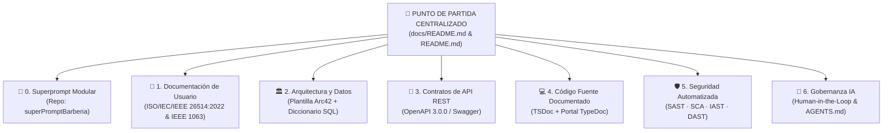

# 📍 Punto de Partida — Centro Maestro de Documentación, Seguridad y Gobernanza IA

> **Proyecto:** Aplicación Web Barberías VIP SaaS (Plataforma Multisede)  
> **Equipo de Desarrollo:** Algoryx  
> **3 Repositorios Oficiales del Ecosistema:**  
> 1. 🧠 **Especificación Viva / Superprompt Modular:** [`superPromptBarberia`](https://github.com/dfelipe7/superPromptBarberia)  
> 2. 🗄️ **Servidor Back-end:** [`Barberia-Backend`](https://github.com/dfelipe7/Barberia-Backend)  
> 3. 💻 **Interfaz Front-end:** [`Barberia-Frontend`](https://github.com/dfelipe7/Barberia-Frontend)

---

## 🎯 Propósito de este Documento (Single Source of Truth)

Además del repositorio **[`superPromptBarberia`](https://github.com/dfelipe7/superPromptBarberia)** (que contiene los prompts modulares de construcción para IA), este archivo actúa como el **Punto Único de Partida (Hub Centralizado)** del proyecto. Desde aquí cualquier evaluador, desarrollador o auditor puede acceder en un solo clic a todos los entregables normativos de **Documentación**, **Pruebas de Seguridad (SSDLC)** y **Gobernanza de Desarrollo con IA (Human-in-the-Loop)**.

---

## 🧠 0. Especificación Génesis: Superprompt Modular (`superPromptBarberia`)

* **¿En qué se diferencia de Arc42 y de los demás estándares?**: Mientras **Arc42, OpenAPI e ISO 26514** son estándares formales para que **personas** (arquitectos, programadores y usuarios) entiendan y auditen el sistema construido, el **Superprompt Modular** es la especificación ejecutable dividida en secciones (`backend/` y `frontend/`) diseñada para guiar a los **modelos de IA** sin desbordar su ventana de contexto:

| Entregable en `superPromptBarberia` | ¿Qué contiene? | Enlace Directo en GitHub |
| :--- | :--- | :--- |
| **Repositorio Oficial del Superprompt** | Estructura modular de prompts de ingeniería compilados automáticamente con `python build.py` y validados en GitHub Actions (`superprompt.yml`). | [`github.com/dfelipe7/superPromptBarberia`](https://github.com/dfelipe7/superPromptBarberia) |
| **Superprompt Maestro Unificado** | Compilado Full-Stack que une las 12 secciones de Backend y las 11 secciones de Frontend. | [`SUPERPROMPT.md`](https://github.com/dfelipe7/superPromptBarberia/blob/master/SUPERPROMPT.md) |
| **Superprompt de Backend (12 secciones)** | Directivas IA (`00`), contexto (`01`), RBAC (`02`), stack (`03`), aislamiento multitenant (`04`), modelo Prisma (`05`), OWASP (`06`), DTOs (`07`), integraciones (`08`), pruebas (`09`), HITL (`10`) y bootstrap (`11`). | [`backend/SUPERPROMPT_BACKEND.md`](https://github.com/dfelipe7/superPromptBarberia/blob/master/backend/SUPERPROMPT_BACKEND.md) |
| **Superprompt de Frontend (11 secciones)** | Directivas IA (`00`), alcance (`01`), sesiones por pestaña (`02`), React 19/Vite (`03`), rutas `/:slug` (`04`), historias de usuario (`05`), temas y mapas (`06`), Axios (`07`), Vitest (`08`), HITL (`09`) y bootstrap (`10`). | [`frontend/SUPERPROMPT_FRONTEND.md`](https://github.com/dfelipe7/superPromptBarberia/blob/master/frontend/SUPERPROMPT_FRONTEND.md) |
| **Protocolo IA Responsable y HITL** | Define los dos niveles de *Human-in-the-Loop* (**Dev-HITL** en desarrollo y **App-HITL** en operación de barberías) y las compuertas de decisión humana. | [`backend/secciones/10-ia-responsable-hitl.md`](https://github.com/dfelipe7/superPromptBarberia/blob/master/backend/secciones/10-ia-responsable-hitl.md) |

---

## 📘 1. Documentación de Usuario Final (ISO/IEC/IEEE 26514:2022 e IEEE Std 1063-2001)

Documentación orientada a los **4 roles operativos del sistema** (Cliente Final, Barbero, Administrador de Barbería y Superadministrador), junto con sus matrices de verificación y auditoría contra el código real:

| Entregable | ¿Qué contiene? | Enlace Directo |
| :--- | :--- | :--- |
| **Plan de Documentación (Cláusula 6 ISO 26514)** | Define antes de escribir el público objetivo (4 roles), convenciones tipográficas, reglas de cero invención y mantenimiento continuo junto al código. | [`docs/PLAN_DE_DOCUMENTACION_ISO_26514.md`](./PLAN_DE_DOCUMENTACION_ISO_26514.md) |
| **Manual de Usuario v2.1.0** | Guía paso a paso con **13 procedimientos operativos**, respuestas visuales del sistema, advertencias previas a acciones riesgosas, glosario y solución a **15 errores reales**. | [`docs/MANUAL_DE_USUARIO.md`](./MANUAL_DE_USUARIO.md) |
| **Matriz de Verificación contra Código** | Cruza **38 afirmaciones del manual** (rutas, botones, límites de archivo y mensajes) con el archivo exacto de programación en Back-end y Front-end. | [`docs/usuario/verificacion.md`](./usuario/verificacion.md) |
| **Matriz de Cumplimiento Normativo** | Evaluación cláusula por cláusula contra **ISO/IEC/IEEE 26514:2022** e **IEEE Std 1063-2001** (14/16 cláusulas cubiertas en código; 2 pendientes humanos de capturas y firma). | [`docs/usuario/matriz-cumplimiento-normas.md`](./usuario/matriz-cumplimiento-normas.md) |
| **Especificación de Capturas de Pantalla** | Guía técnica con nombres de archivo, dimensiones (`390 px` móvil y `1280 px` escritorio) y privacidad para las 8 capturas operativas. | [`docs/usuario/img/LEEME.md`](./usuario/img/LEEME.md) |

---

## 🏛️ 2. Arquitectura de Software y Base de Datos (Estándar Arc42)

Diseño interno del sistema multisede explicado para ingenieros y desarrolladores siguiendo las **12 secciones de la plantilla internacional Arc42**:

| Entregable | ¿Qué contiene? | Enlace Directo |
| :--- | :--- | :--- |
| **Índice Maestro Arc42 (12/12 capítulos)** | Punto de entrada a los 12 capítulos de arquitectura (metas, restricciones, contexto C4, estrategia de solución, bloques, runtime, despliegue, conceptos transversales, ADRs, calidad, riesgos y glosario). | [`docs/arc42/README.md`](./arc42/README.md) |
| **Decisiones Arquitectónicas (ADRs)** | Justificación técnica del aislamiento multitenant por `negocio_id`, cálculo de precios en servidor y autenticación federada con Google. | [`docs/arc42/09_decisiones_arquitectonicas.md`](./arc42/09_decisiones_arquitectonicas.md) |
| **Diccionario de Datos (MariaDB / Prisma)** | Detalle completo de las **24 tablas** del esquema relacional, columnas, tipos de datos, llaves foráneas e índices de concurrencia. | [`docs/DICCIONARIO_DE_DATOS.md`](./DICCIONARIO_DE_DATOS.md) |
| **Inventario de Deuda Técnica** | Registro transparente de compromisos técnicos (`DEBT-XXX`) y su estado de resolución en ambos repositorios. | [`TECH_DEBT.md`](../TECH_DEBT.md) |

---

## 🔌 3. Catálogo de Rutas y Contratos REST (Estándar OpenAPI 3.0.0)

Especificación de las **76 rutas y 105 operaciones HTTP** que comunican la interfaz web (`Barberia-Frontend`) con el servidor (`Barberia-Backend`):

| Entregable | ¿Qué contiene? | Enlace Directo |
| :--- | :--- | :--- |
| **Especificación Formal OpenAPI 3.0 (JSON)** | Contrato completo autogenerado desde los decoradores de NestJS (importable en Postman, Insomnia o Swagger Editor). | [`docs/api/openapi.json`](./api/openapi.json) |
| **Script Generador de OpenAPI** | Programa que extrae automáticamente el contrato `openapi.json` sin editarlo a mano (`npm run openapi:export`). | [`scripts/export-openapi.js`](../scripts/export-openapi.js) |
| **Referencia de API en Español** | Explicación funcional de los módulos de negocio, parámetros y respuestas esperadas por cada ruta. | [`docs/api/REFERENCIA_API.md`](./api/REFERENCIA_API.md) |
| **Matriz de Auditoría de Endpoints** | Tabla completa con los permisos, guardias JWT y aislamiento por sede de las operaciones expuestas. | [`docs/api/MATRIZ_AUDITORIA_ENDPOINTS.md`](./api/MATRIZ_AUDITORIA_ENDPOINTS.md) |
| **Contratos Multitenant Front ↔ Back** | Reglas de envío de la cabecera `X-Negocio-Slug`, manejo de sesiones por pestaña y estructura de respuestas. | [`CONTRATOS_API_MULTITENANT.md`](../CONTRATOS_API_MULTITENANT.md) |

---

## 💻 4. Documentación en el Código Fuente (TSDoc & TypeDoc)

Documentación escrita directamente encima de las clases, servicios y funciones mediante etiquetas estándar (`@remarks`, `@param`, `@returns`, `@throws`) para generar el portal web técnico con `npm run docs:html`:

| Entregable | ¿Qué contiene? | Enlace Directo |
| :--- | :--- | :--- |
| **Portada del Portal Técnico (Developer Hub)** | Mapa de dominios de negocio y flujo arquitectónico que sirve como página de inicio del portal HTML de TypeDoc. | [`docs/DOCS_PORTAL.md`](./DOCS_PORTAL.md) |
| **Configuración de TypeDoc (Back-end)** | Reglas para compilar el portal técnico sobre los **201 archivos `.ts`** del servidor (**86% de cobertura TSDoc**). | [`typedoc.json`](../typedoc.json) |
| **Documentación de Capa API (Front-end)** | Guía interna y scripts de generación TypeDoc sobre la interfaz web React (**34% de cobertura TSDoc**). | [`Barberia-Frontend/src/api/README.md`](https://github.com/dfelipe7/Barberia-Frontend/blob/feature/multitenant-core-fixes/src/api/README.md) |

---

## 🛡️ 5. Pruebas de Seguridad en el Ciclo de Vida (SAST, SCA, IAST, DAST)

Implementación automatizada de las 4 técnicas de seguridad en GitHub Actions:

| Técnica | ¿Qué revisa y con qué herramientas? | Archivos de Configuración en GitHub |
| :--- | :--- | :--- |
| **Documento Maestro de Seguridad** | Explicación integral de las 4 técnicas, comandos de ejecución y guía para descargar los reportes de auditoría. | [`docs/SEGURIDAD_Y_TESTING.md`](./SEGURIDAD_Y_TESTING.md) |
| **1. SAST (Caja Blanca — Código en frío)** | Revisa nuestro código sin encender el servidor con **SonarQube Cloud**, **TypeScript** y **ESLint**. | • Back-end: [`sonar-project.properties`](../sonar-project.properties) · [`workflows/build.yml`](../.github/workflows/build.yml) · [`eslint.config.mjs`](../eslint.config.mjs) • Front-end: [`sonar-project.properties`](https://github.com/dfelipe7/Barberia-Frontend/blob/feature/multitenant-core-fixes/sonar-project.properties) · [`workflows/build.yml`](https://github.com/dfelipe7/Barberia-Frontend/blob/feature/multitenant-core-fixes/.github/workflows/build.yml) |
| **2. SCA (Librerías Externas)** | Revisa que los paquetes descargados (`node_modules`) no tengan fallos conocidos usando **`npm audit`**, **Dependabot** y **`overrides`**. | • Back-end: [`workflows/security-audit.yml`](../.github/workflows/security-audit.yml) · [`dependabot.yml`](../.github/dependabot.yml) · [`package.json (overrides)`](../package.json) • Front-end: [`workflows/security-audit.yml`](https://github.com/dfelipe7/Barberia-Frontend/blob/feature/multitenant-core-fixes/.github/workflows/security-audit.yml) · [`dependabot.yml`](https://github.com/dfelipe7/Barberia-Frontend/blob/feature/multitenant-core-fixes/.github/dependabot.yml) |
| **3. IAST (Sensor en Servidor Encendido)** | Conecta el sensor **`dd-trace` de Datadog** dentro del servidor mientras corren las pruebas para vigilar consultas SQL a MariaDB en vivo. | • Back-end: [`src/datadog.ts`](../src/datadog.ts) · [`src/main.ts`](../src/main.ts) · [`workflows/iast-datadog.yml`](../.github/workflows/iast-datadog.yml) |
| **4. DAST (Caja Negra — Ataque Externo)** | Enciende el servidor y lo ataca desde afuera con el escáner **OWASP ZAP** sobre `/api/docs`, generando el reporte `zap_report.html`. | • Back-end: [`workflows/dast-zap.yml`](../.github/workflows/dast-zap.yml) · [`scripts/testing/zap-run.mjs`](../scripts/testing/zap-run.mjs) |

---

## 🤖 6. Gobernanza de IA y Control Humano (*Human-in-the-Loop*)

El proyecto cuenta con **100% de asistencia de IA** como herramienta generadora, bajo un marco estricto donde **el equipo humano Algoryx valida, prueba, corrige y autoriza cada cambio**:

| Componente | ¿Qué regla aplica? | Enlaces en GitHub |
| :--- | :--- | :--- |
| **Reglamento de Agentes (`AGENTS.md`)** | Flujo obligatorio (*Auditar ➔ Proponer ➔ Esperar "OK" humano ➔ Ejecutar ➔ Verificar*). **Prohibido que la IA haga `commit`, `push` o `merge` sola.** El autor es siempre el humano. | • Back-end: [`Barberia-Backend/AGENTS.md`](../AGENTS.md) • Front-end: [`Barberia-Frontend/AGENTS.md`](https://github.com/dfelipe7/Barberia-Frontend/blob/feature/multitenant-core-fixes/AGENTS.md) |
| **Bitácora Auditable de Sesiones (`.ai/sessions/`)** | Registro versionado de las tareas asistidas por IA (prompt original, plan aplicado, archivos modificados y pruebas ejecutadas). | • Back-end: [`.ai/sessions/`](../.ai/sessions/) • Front-end: [`Barberia-Frontend/.ai/sessions/`](https://github.com/dfelipe7/Barberia-Frontend/tree/feature/multitenant-core-fixes/.ai/sessions) |
| **Candados Automáticos en Git (`setup-ai-hooks`)** | Scripts que configuran los hooks locales (`prepare-commit-msg` y `commit-msg`) para exigir los trailers `AI-Assisted-By`, `AI-Model` y `AI-Session`. | • Back-end: [`scripts/setup-ai-hooks.ps1`](../scripts/setup-ai-hooks.ps1) • Front-end: [`Barberia-Frontend/scripts/setup-ai-hooks.ps1`](https://github.com/dfelipe7/Barberia-Frontend/blob/feature/multitenant-core-fixes/scripts/setup-ai-hooks.ps1) |
