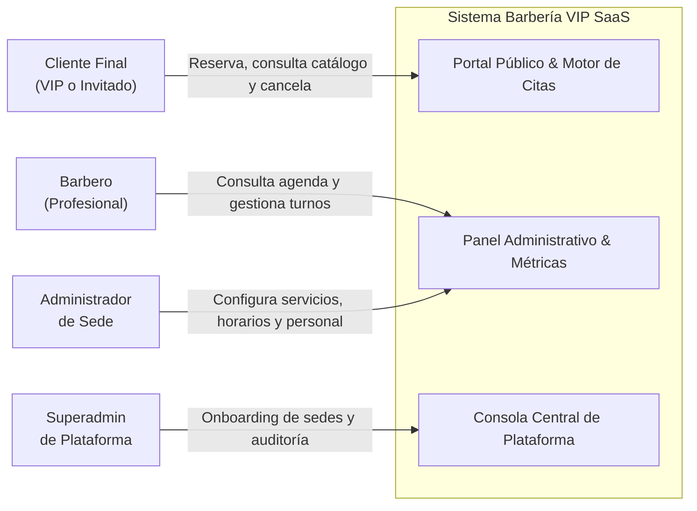
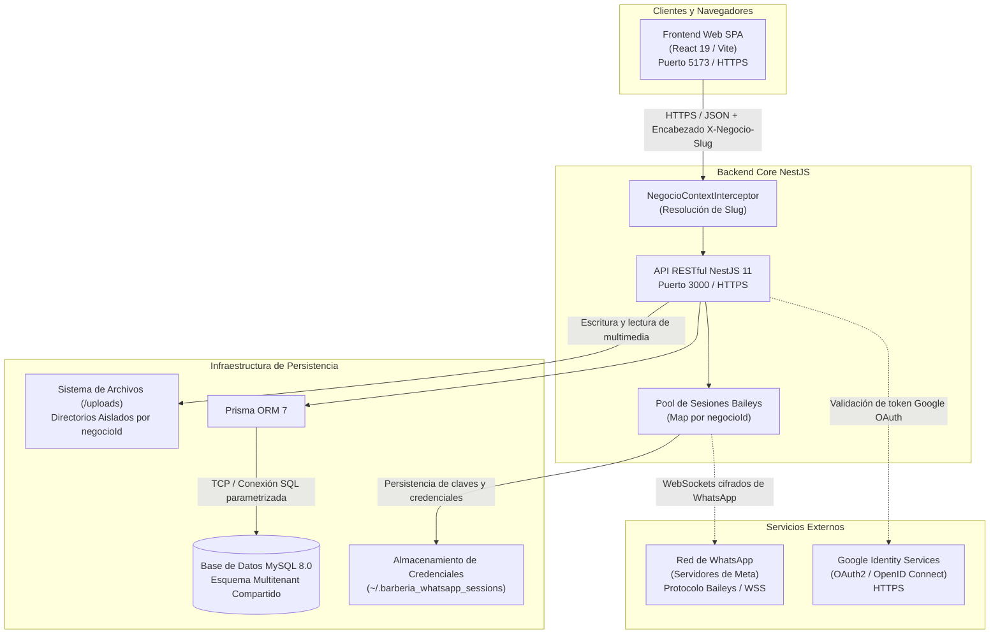

# 03. Alcance y Contexto del Sistema (Arc42 §3)

El alcance define las fronteras entre el sistema Barbería VIP SaaS y su entorno externo.

---

## 3.1 Contexto de Negocio

El sistema interactúa con los siguientes actores y canales de negocio:

### Mapeo de Canales de Negocio

| Actor | Canal de Entrada | Acciones Principales | Canal de Salida |
| :--- | :--- | :--- | :--- |
| **Cliente** | Navegador Web / Móvil (`/:slug/reservar`) | Selección de servicio, barbero y franja horaria. | Comprobante digital en pantalla y mensaje de confirmación por WhatsApp. |
| **Barbero** | Navegador Web (`/:slug/dashboard`) | Consulta de agenda diaria, marcar cita completada o inasistencia. | Vista reactiva de citas y cálculo de comisiones generadas. |
| **Admin** | Navegador Web (`/:slug/configuracion`) | Modificación de precios, horarios, vinculación de WhatsApp y tema. | Catálogo actualizado para clientes y socket WhatsApp conectado. |
| **Superadmin** | Navegador Web (`/plataforma`) | Creación de nuevas barberías y auditoría global. | Nueva sede operativa accesible bajo su propio subdominio/slug. |

---

## 3.2 Contexto Técnico

El diagrama describe los límites del sistema con los servicios, protocolos y almacenamiento técnico circundante:

### Interfases Técnicas Externas

1. **Interfaz de Clientes (HTTP / JSON):**
   * Protocolo: HTTPS, formato de intercambio JSON.
   * Encabezado de Contexto: `X-Negocio-Slug` identifica la sede en cada solicitud.
   * Autenticación: Tokens JWT en encabezado `Authorization: Bearer <token>` o cookies seguras `HttpOnly`.
2. **Interfaz de Identidad Federada (Google OAuth2):**
   * Verificación criptográfica del token `sub` de Google para mitigar secuestros de cuenta.
3. **Interfaz de WhatsApp (Baileys WebSockets):**
   * Protocolo binario WebSocket cifrado de extremo a extremo que interactúa con la red de WhatsApp emulando un cliente web oficial por cada sede.
