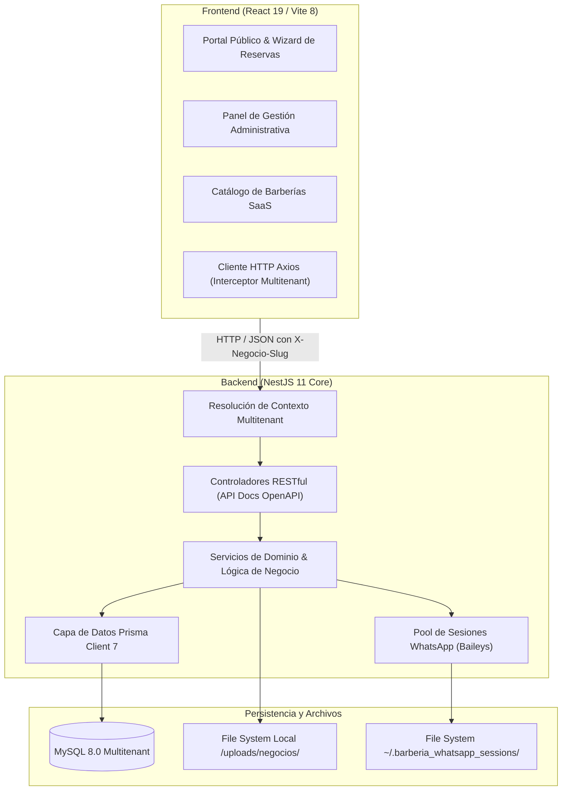

# 05. Vista de Componentes y Bloques de Construcción (Arc42 §5)

La vista de bloques descompone el sistema jerárquicamente en subsistemas, módulos y componentes.

---

## 5.1 Nivel 1: Sistema General de Caja Blanca



---

## 5.2 Nivel 2: Módulos del Backend (Cajas Negras)

El backend se organiza en módulos de dominio de alta cohesión y bajo acoplamiento:

| Módulo | Responsabilidad Principal | Interfases Expuestas |
| :--- | :--- | :--- |
| **`auth/`** | Autenticación local con bcrypt, emisión/rotación de JWT, Google OAuth2 con mitigación anti-takeover y autenticación de clientes invitados. | `POST /auth/login`<br>`POST /auth/google`<br>`POST /auth/clientes/...` |
| **`common/`** | Funcionalidades transversales: resolución de tenant (`NegocioContextInterceptor`), guards de roles (`RolesGuard`, `JwtAuthGuard`), sanitización de SVG, detección de tipo de archivo y configuración de Multer. | Decoradores `@NegocioActual()`, `@RolesPermitidos()`, interceptores globales. |
| **`modules/negocios/`** | Registro y aprovisionamiento de nuevas barberías (*onboarding*), listado público de sedes registradas y validación de unicidad de slugs. | `GET /negocios`<br>`POST /negocios`<br>`GET /negocios/:slug` |
| **`modules/perfil-negocio/`** | Información comercial de la sede (teléfono, dirección, coordenadas GPS, enlace de Google Maps, redes sociales y URLs de logos/banner). | `GET /perfil-negocio/publico`<br>`PUT /perfil-negocio`<br>`CRUD /redes-sociales` |
| **`modules/usuarios/`** | Administración de miembros del equipo de trabajo (`Administrador` y `Barbero`). Permite activar o suspender miembros localmente sin afectar cuentas globales. | `GET /usuarios/equipo`<br>`POST /usuarios/invitar`<br>`PATCH /usuarios/:id/estado` |
| **`modules/servicios/`** | Catálogo de servicios de corte y estética, asignación de precios, duración en minutos y vinculación con barberos habilitados. | `GET /servicios`<br>`POST /servicios`<br>`PUT /servicios/:id`<br>`DELETE /servicios/:id` |
| **`modules/horarios/`** | Definición de horarios semanales de atención por barbero, configuración de días de descanso y bloqueos de agenda por fechas especiales. | `GET /horarios/disponibilidad`<br>`PUT /horarios/semanal`<br>`POST /horarios/bloqueos` |
| **`modules/reservas/`** | Motor transaccional de citas. Creación con bloqueo atómico (`crearConBloqueo`), cálculo de horas libres de 60 minutos, cambios de estado y cancelaciones seguras. | `GET /reservas`<br>`POST /reservas`<br>`PATCH /reservas/:id/estado`<br>`POST /reservas/:id/cancelar` |
| **`modules/whatsapp/`** | Administración del pool de sockets Baileys por negocio, generación de código QR para vinculación, reconexión automática y despacho de plantillas. | `GET /whatsapp/qr`<br>`GET /whatsapp/status`<br>`POST /whatsapp/desconectar` |
| **`modules/configuracion/`** | Parámetros operativos y variables de negocio por sede. | `GET /configuracion`<br>`PUT /configuracion` |
| **`modules/alerts/`** | Despacho de notificaciones operativas internas de la plataforma. | Servicio interno. |
| **`prisma/`** | Servicio singleton de base de datos que encapsula transacciones y extensiones de Prisma Client. | Inyección de dependencias `PrismaService`. |

---

## 5.3 Nivel 3: Detalle de Componentes Críticos

### Componente `ReservasService` y `ReservasRepository`
* **Propósito:** Orquestar la creación de citas asegurando que no existan colisiones de agenda.
* **Mecanismo:** Encapsula la lógica transaccional de disponibilidad dentro de un bloque protegido:
  ```
  ReservasController -> ReservasService -> ReservasRepository.crearConBloqueo -> Prisma.$transaction
  ```
* **Garantía:** Si dos solicitudes concurrentes intentan reservar la misma hora con el mismo barbero, solo la primera completa la inserción; la segunda es rechazada con un error HTTP 409 Conflict.

### Componente `WhatsAppService` (Pool de Baileys)
* **Propósito:** Mantener conexiones WebSocket independientes con la red de WhatsApp por cada `negocioId`.
* **Estructura Interna:**
  * `sesiones`: Mapa en memoria `Map<number, SesionWhatsAppNegocio>` que almacena el socket de Baileys, el estado de autenticación y el código QR actual.
  * `colasPendientes`: Mapa en memoria `Map<number, MensajeColaWhatsApp[]>` que retiene los mensajes si la sesión experimenta desconexión transitoria.
  * `directorioSesiones`: Almacén persistente en disco particionado por sede (`~/.barberia_whatsapp_sessions/negocio_<id>`).
