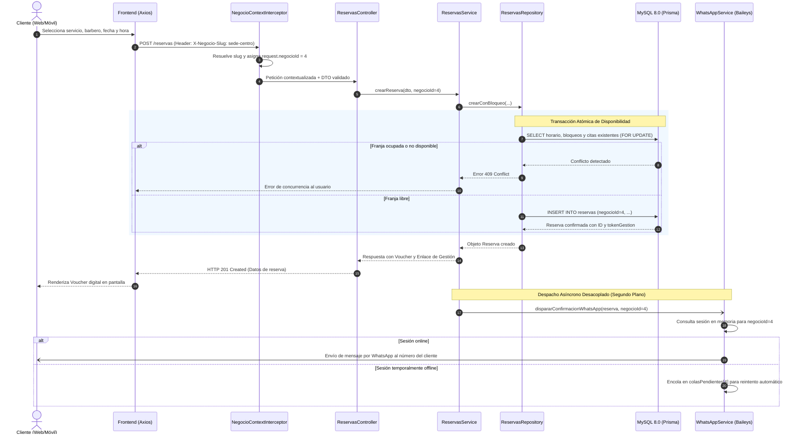
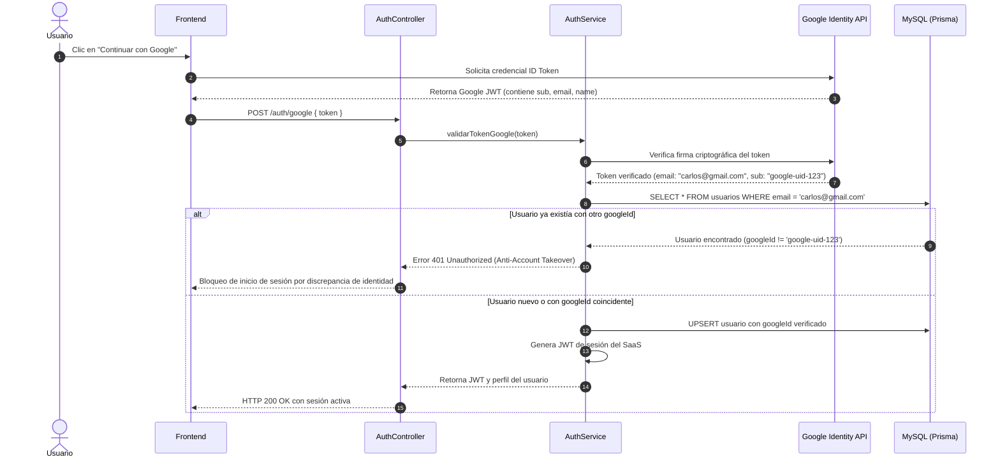
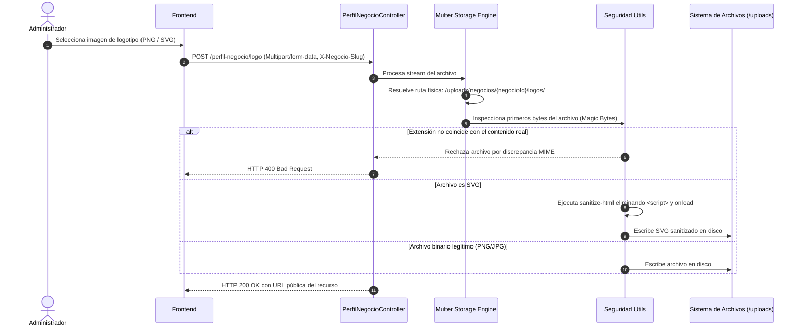

# 06. Vista de Tiempo de Ejecución (Arc42 §6)

La vista de ejecución describe el comportamiento dinámico y las interacciones temporales entre componentes durante escenarios clave.

---

## 6.1 Escenario 1: Creación Atómica de Cita y Notificación Asíncrona por WhatsApp

Describe el ciclo de vida completo desde que un cliente solicita un turno hasta que se confirma y notifica:

---

## 6.2 Escenario 2: Autenticación con Google OAuth2 y Protección Anti-Takeover

Garantiza que una cuenta registrada localmente con un correo no sea suplantada por un inicio de sesión de Google con un `sub` distinto:

---

## 6.3 Escenario 3: Subida y Sanitización de Recursos de Marca

Muestra cómo se garantiza el aislamiento en disco y la seguridad ante archivos maliciosos:

