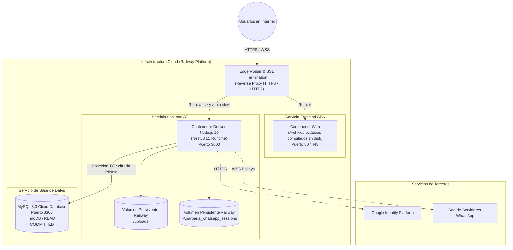
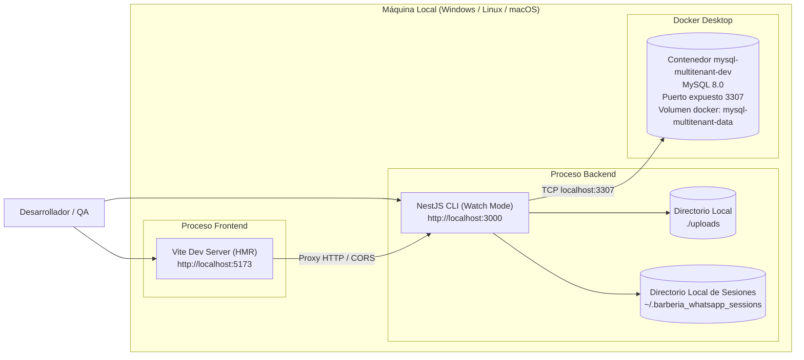

# 07. Vista de Despliegue (Arc42 §7)

La vista de despliegue describe la infraestructura técnica donde se ejecutan los artefactos de software y el mapeo de los componentes a nodos físicos o en la nube.

---

## 7.1 Nivel de Infraestructura 1: Entorno de Producción Cloud (Railway)



### Mapeo de Componentes a Infraestructura

| Componente de Software | Unidad de Despliegue | Nodo de Ejecución | Almacenamiento Asociado |
| :--- | :--- | :--- | :--- |
| **Frontend Web** | Paquete compilado estático (HTML, JS, CSS) | Nginx Server en Railway | Caché en borde (Edge Cache) |
| **Backend API** | Imagen Docker generada desde `Dockerfile` | Contenedor Node.js 20 | Memoria RAM (Pool Baileys) |
| **Almacenamiento Multimedia** | Directorio físico `/uploads` | Montaje de volumen persistente | Sistema de archivos particionado |
| **Credenciales WhatsApp** | Directorio `~/.barberia_whatsapp_sessions` | Montaje de volumen persistente | Archivos de autenticación Baileys |
| **Capa de Datos** | Esquema relacional administrado | Contenedor MySQL 8.0 | Disco SSD NVMe transaccional |

---

## 7.2 Nivel de Infraestructura 2: Entorno de Desarrollo Local (Docker Compose)

Para reproducir fielmente el entorno productivo en el equipo de desarrollo sin dependencias externas:



### Comandos de Operación Local

1. **Levantar base de datos aislada:**
   ```bash
   docker compose -f docker-compose.multitenant-dev.yml up -d mysql-multitenant-dev
   ```
2. **Aplicar migraciones:**
   ```bash
   npx prisma migrate deploy
   ```
3. **Poblar datos de prueba (Seed):**
   ```bash
   npm run seed:local:multitenant
   ```
4. **Iniciar backend en modo observador:**
   ```bash
   npm run start:dev
   ```
